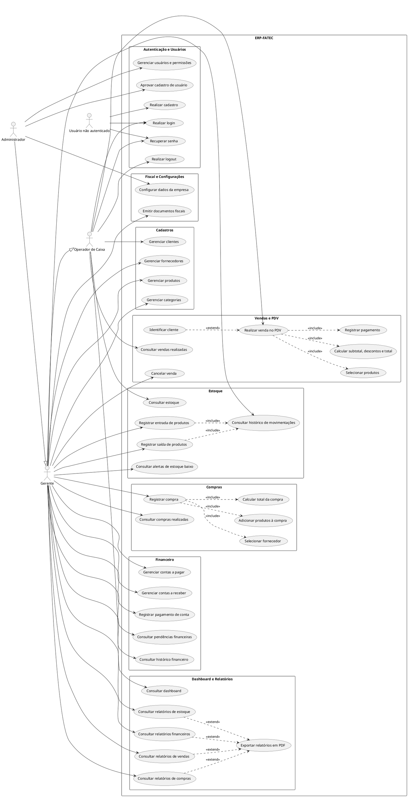

# Diagrama UML de Casos de Uso — MERP
![alt](https://www.plantuml.com/plantuml/png/ZLZDRkCs4BxxAGQvvDBi0nGBOmEliorGe6cocsin8SSoiJBfabIQ_lHTMlHGe41FHI-z-iMMf3IcGj5QvoJDVD_duN1cAEQDysXzjsiNBMqyU0DMDLiFKbaINXczS1-LtgF57UnHVCI6xlrFBK5qesvQ6W7S5gNvKUa6DjWwMYnGU6FXueFh3dzOPK0V_ZI0dIVjbGZO2q073ygf8EM9uT_koGQd1KcmGlMC2SPMHhqZIu6KVCCpkwxbJcdbVC8dGB8i5iUWuM9zTtjrS_r-lRg0NnOB0E3b1Je7UFWhnal0yRk8XU6lSoJG1VWTOQj-HWi29Jfl-rLzM7s_6jvdAArfb6RyD_5b7cmwdz7nhGONNKoL1KTwYmo_ZozJzFNUcgTHx37dtR1SfWwOAJcbNQX0Pue3WZtPdNBky1yvLWW9nEXD4hyLwUOqbTajVqEqYhJFeglXVOwpCLQJ86bivjrasomth5fstXnvjyFxR8pegJ5MOOwIBVN5hvqtFtHKNVhAQDUrFiZIW69DTWpiMX4qgVu3LSSsG90qMT2wTysn7Hx-gPFlKKcSYtaR90x_MYLIJUtCazgHzg6dneNnLG2PY9bJmfQi3tX9d0XuHFMSwpFvw_bz82q3Yk3sxSDyzpv596WJaQoSs5FEFRKabD6L8ickAUrh6SVAHebSp4mRkIgPm5PqRI2vxj4RZ-qN8Ca9ettgjsHY8SRERUeU6unxOOwLpOQvNNZgCsdxV8N7IJNskQx5hmMrBC4qjjPdWjdjBPOJeLo8I2WMJ9pvtShZOBfVUInKfgHKnNx3uVVYvu-OCevo6_iD0uc5mFjeFadc9FUa-OteHUeDSQDqJBoovdFZrkZOT9ZAnOvBnPv5ioJeaOx4k_HwNbs2f5w7oTzrogEToygUj3py7KDmiE4bOfxTmKt9Uzx8oXfcCgfo1gi9Vejk-sZGIY2uenQJed6VcV2IMVnpHvavbitw86beqPpnbZloN0Kkhf44rzBv6lcmOWq-fixKoBaV1vBJFjLPF--DBMLe5qRv3Ik4nnFzu0IsG11YsQYcitn2rVPhlLDUMP16TB5GKwo1hevnzcfJ8ekddPOnJmWK4aiEcTf3nZ5UflhfmqddE45GwvFSkJuDV4Z1grVBb_CCleJNhvKMRITfkQo0-R0u1vgFY2csEByIW-a9JSy-F0Sme_kQOc1b11SHLNdbm3s7aaTi2MTy_qt4XDpqTVLxLAUnXNJkHoQ4adoPdmnCCPw3vDwQHnODT18S2kyIhWKvPs1_-F-nZLzcn_iPN5qjH_UQqiCtcCBCTuyWdUzm_F2IMB6QpXTcbYki-JfGEiglvHBGL-ffMd9FPVE0Nbpo1HIsP2K2kl4b2AG1mmiVW47arsLEHxOkonjAwUDRI67FzupImoLTcbFj5iPSmwM3lx4BCt_4bVQ-VgVMuWEbN1isfHH_E9Hc_YGehFcSBporuxk0v0QjE4v4d1kmugd_KZucKhED_rLnidoQdhv8wBvstXMcvVYcFZRcotUsvkFc3MdPxTfF)
## 1. Objetivo

Este documento apresenta o diagrama UML de casos de uso do MERP. O diagrama representa, de forma visual, as principais funcionalidades previstas para o sistema e os tipos de usuários que podem interagir com elas.

O modelo foi elaborado com base na documentação e no backlog do projeto. Portanto, ele representa tanto funcionalidades descritas para o sistema quanto funcionalidades planejadas.

## 2. Atores do sistema

Os atores representam os perfis de usuário que interagem com o ERP.

| Ator | Descrição |
|---|---|
| **Usuário não autenticado** | Pessoa que ainda não entrou no sistema. Pode realizar cadastro, acessar a tela de login e solicitar recuperação de senha. |
| **Operador de Caixa** | Usuário voltado às atividades operacionais do dia a dia, como consultar estoque e clientes e registrar vendas no PDV. |
| **Gerente** | Usuário com permissões ampliadas para gerenciar cadastros, movimentações de estoque, compras, financeiro e relatórios, além das atividades atribuídas ao operador. |
| **Administrador** | Usuário responsável pela administração do sistema, incluindo aprovação de cadastros, gerenciamento de usuários e permissões e configuração dos dados da empresa. |

### Hierarquia de permissões

No diagrama, a generalização entre os atores indica uma hierarquia de permissões:

- O **Gerente** herda as permissões atribuídas ao **Operador de Caixa** e possui permissões adicionais.
- O **Administrador** herda as permissões atribuídas ao **Gerente** e possui permissões administrativas adicionais.

Essa hierarquia é uma representação simplificada para facilitar a leitura. As permissões definitivas devem seguir as regras de autorização efetivamente adotadas pelo projeto.

## 3. Módulos e casos de uso

### 3.1. Autenticação e usuários

Reúne as funcionalidades de acesso e administração de contas:

- Realizar cadastro;
- Realizar login e logout;
- Recuperar senha;
- Aprovar cadastro de usuário;
- Gerenciar usuários e permissões.

A aprovação de cadastros e a administração de permissões são representadas como responsabilidades administrativas.

### 3.2. Cadastros

Agrupa o gerenciamento dos principais registros utilizados pelo ERP:

- Clientes;
- Fornecedores;
- Produtos;
- Categorias de produtos.

Esses cadastros fornecem informações utilizadas nas operações de venda, compra e controle de estoque.

### 3.3. Estoque

Representa as operações de acompanhamento e movimentação dos produtos:

- Consultar estoque;
- Registrar entradas e saídas;
- Consultar o histórico de movimentações;
- Consultar alertas de estoque baixo.

As movimentações de entrada e saída devem manter o histórico necessário para acompanhar as alterações nas quantidades dos produtos.

### 3.4. Vendas e PDV

Representa o processo de venda no ponto de venda (PDV), incluindo:

- Realizar venda;
- Selecionar produtos;
- Identificar o cliente, quando aplicável;
- Calcular subtotal, descontos e total;
- Registrar pagamento;
- Consultar vendas realizadas;
- Cancelar venda.

O caso de uso **Realizar venda no PDV** está relacionado às etapas necessárias para concluir uma venda. A identificação do cliente foi modelada como comportamento opcional, pois nem toda venda precisa necessariamente estar vinculada a um cliente cadastrado.

O cancelamento de vendas é apresentado como uma funcionalidade prevista no modelo; sua disponibilidade e suas regras devem ser confirmadas na implementação.

### 3.5. Compras

Reúne as operações de registro e consulta de compras:

- Registrar compra;
- Selecionar fornecedor;
- Adicionar produtos à compra;
- Calcular o total da compra;
- Consultar compras realizadas.

O registro de uma compra deve permitir identificar o fornecedor, os produtos envolvidos e o valor total da operação. Quando implementada a integração com estoque, a entrada dos produtos comprados deve refletir-se nas quantidades disponíveis.

### 3.6. Financeiro

Representa o controle financeiro da empresa:

- Gerenciar contas a pagar;
- Gerenciar contas a receber;
- Registrar pagamento de contas;
- Consultar pendências financeiras;
- Consultar histórico financeiro.

**Importante:** neste diagrama, o módulo financeiro se refere ao controle financeiro operacional da empresa, como contas a pagar e a receber, previsto no backlog. Ele não deve ser confundido com a gestão de cobranças da assinatura ou do plano de utilização do próprio ERP.

### 3.7. Dashboard e relatórios

Reúne funcionalidades de consulta e acompanhamento gerencial:

- Consultar dashboard;
- Consultar relatórios de vendas;
- Consultar relatórios de compras;
- Consultar relatórios de estoque;
- Consultar relatórios financeiros;
- Exportar relatórios em PDF.

O dashboard apresenta informações resumidas, enquanto os relatórios permitem consultar dados de áreas específicas. A exportação em PDF está incluída como funcionalidade planejada e deve ser confirmada na versão implementada.

### 3.8. Fiscal e configurações

Inclui funcionalidades relacionadas à emissão de documentos fiscais e às configurações da empresa:

- Emitir documentos fiscais;
- Configurar dados da empresa.

A emissão de documentos fiscais deve respeitar as permissões dos perfis e os requisitos técnicos e legais aplicáveis. A configuração dos dados da empresa foi atribuída ao administrador no modelo.

## 4. Relacionamentos UML utilizados

O diagrama utiliza os seguintes tipos de relacionamento:

### Associação

É representada por uma linha entre um ator e um caso de uso. Indica que aquele perfil pode interagir com a funcionalidade correspondente.

### `<<include>>`

Indica que um caso de uso inclui obrigatoriamente o comportamento de outro como parte de seu fluxo.

No diagrama, a realização de uma venda inclui a seleção de produtos, o cálculo dos valores e o registro do pagamento. O registro de uma compra inclui a seleção do fornecedor, a adição de produtos e o cálculo do total.

### `<<extend>>`

Indica um comportamento adicional ou opcional que pode ocorrer em determinadas condições durante outro caso de uso.

No diagrama, a identificação do cliente estende o caso de uso de realização de venda, pois pode ser opcional. A exportação em PDF foi representada como extensão dos casos de uso de consulta de relatórios.

### Generalização entre atores

É representada por uma linha com triângulo apontando para o ator mais genérico. Indica que o ator especializado herda as relações e permissões representadas para o ator mais genérico.

Neste modelo, o gerente herda as permissões do operador, e o administrador herda as do gerente.

## 5. Código-fonte do diagrama

O diagrama foi escrito em PlantUML, uma linguagem textual que permite gerar diagramas UML a partir de código. O código-fonte deve ser mantido junto à documentação para facilitar futuras alterações.

Para renderizar ou editar o diagrama, utilize o [PlantUML Online Server](https://www.plantuml.com/plantuml/uml/) e cole o código-fonte definido para o diagrama de casos de uso.

Codigo fonte:

## 6. Observações e limitações

O diagrama é um **modelo de referência das funcionalidades do ERP-FATEC**, elaborado com base na documentação e no backlog consultados. Ele não deve ser interpretado automaticamente como uma descrição exata de tudo o que já está implementado.

Algumas funcionalidades representadas — como cancelamento de vendas, exportação de relatórios em PDF, alertas de estoque baixo e determinadas permissões por perfil — precisam ser verificadas na implementação atual do sistema. A presença delas no diagrama indica que foram consideradas no modelo, não que estejam necessariamente disponíveis na versão em produção.

As permissões dos atores também devem ser validadas com as regras reais de autorização do projeto. A hierarquia de operador, gerente e administrador simplifica a apresentação e pode precisar de ajustes conforme a implementação.

Por fim, o diagrama de casos de uso apresenta **o que** os usuários podem fazer no sistema, mas não detalha toda a sequência de telas, validações, regras de negócio ou o funcionamento interno de cada operação. Esses aspectos podem ser documentados separadamente por meio de descrições de casos de uso, diagramas de atividade ou diagramas de sequência.
