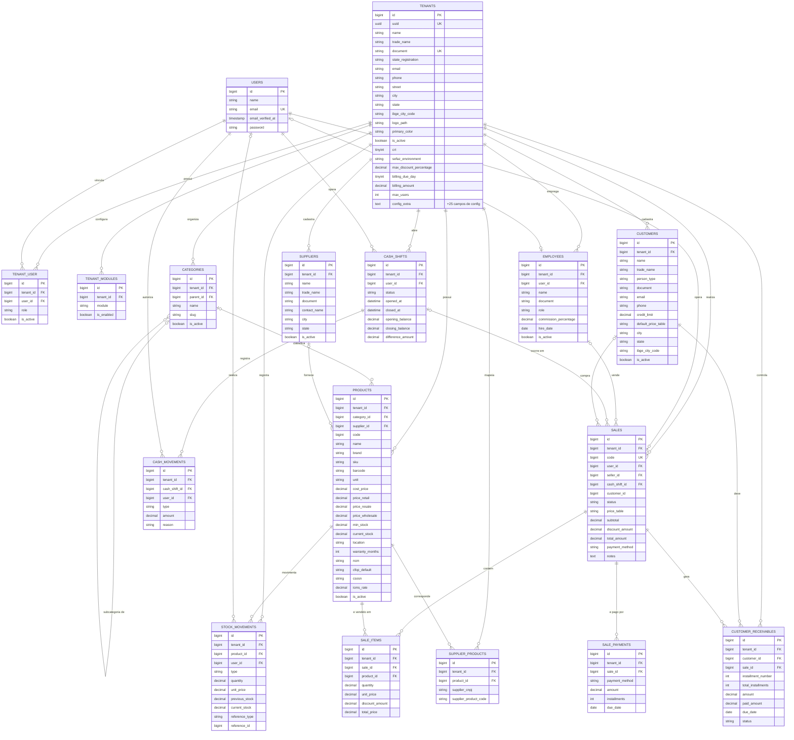

# Modelo de Dados — ERP-FATEC

Documentação do modelo entidade-relacionamento do sistema, cobrindo os módulos **Core**,
**Cadastros**, **Estoque** e **Vendas**. Reconstruído a partir das migrations do projeto
(Laravel + nwidart-modules).

## Diagrama

## Notação

| Símbolo | Significado |
|---|---|
| `PK` | Chave primária |
| `FK` | Chave estrangeira |
| `UK` | Chave única (unique) |
| `\|\|--o{` | Um para muitos (obrigatório → opcional/múltiplo) |
| `\|o--o{` | Zero-ou-um para muitos (FK opcional) |
| `\|o--o\|` | Zero-ou-um para zero-ou-um |

## Relacionamentos

| Entidade origem | Cardinalidade | Entidade destino | Relação |
|---|---|---|---|
| TENANTS | 1:N | TENANT_USER | possui |
| USERS | 1:N | TENANT_USER | vincula |
| TENANTS | 1:N | TENANT_MODULES | configura |
| TENANTS | 1:N | EMPLOYEES | emprega |
| USERS | 0/1:0/1 | EMPLOYEES | é (opcional) |
| TENANTS | 1:N | SUPPLIERS | cadastra |
| TENANTS | 1:N | CATEGORIES | organiza |
| CATEGORIES | 0/1:N | CATEGORIES | subcategoria de |
| TENANTS | 1:N | PRODUCTS | possui |
| CATEGORIES | 0/1:N | PRODUCTS | classifica |
| SUPPLIERS | 0/1:N | PRODUCTS | fornece |
| TENANTS | 1:N | STOCK_MOVEMENTS | registra |
| PRODUCTS | 1:N | STOCK_MOVEMENTS | movimenta |
| USERS | 0/1:N | STOCK_MOVEMENTS | realiza |
| TENANTS | 1:N | SUPPLIER_PRODUCTS | mapeia |
| PRODUCTS | 1:N | SUPPLIER_PRODUCTS | corresponde |
| TENANTS | 1:N | CUSTOMERS | cadastra |
| TENANTS | 1:N | SALES | realiza |
| USERS | 1:N | SALES | opera |
| EMPLOYEES | 0/1:N | SALES | vende |
| CASH_SHIFTS | 0/1:N | SALES | ocorre em |
| CUSTOMERS | 0/1:N | SALES | compra |
| SALES | 1:N | SALE_ITEMS | contém |
| PRODUCTS | 1:N | SALE_ITEMS | é vendido em |
| SALES | 1:N | SALE_PAYMENTS | é pago por |
| TENANTS | 1:N | CASH_SHIFTS | abre |
| USERS | 1:N | CASH_SHIFTS | opera |
| CASH_SHIFTS | 1:N | CASH_MOVEMENTS | registra |
| USERS | 1:N | CASH_MOVEMENTS | autoriza |
| TENANTS | 1:N | CUSTOMER_RECEIVABLES | controla |
| CUSTOMERS | 1:N | CUSTOMER_RECEIVABLES | deve |
| SALES | 1:N | CUSTOMER_RECEIVABLES | gera |

## Dicionário de Dados

### Módulo Core

#### TENANTS
Empresa cliente do sistema (multi-tenant — toda tabela abaixo referencia esta).

| Campo | Tipo | Chave | Descrição |
|---|---|---|---|
| id | bigint | PK | Identificador |
| uuid | uuid | UK | Identificador público |
| name | string | | Razão social |
| trade_name | string | | Nome fantasia |
| document | string | UK | CNPJ ou CPF |
| state_registration | string | | Inscrição estadual |
| email | string | | E-mail de contato |
| phone | string | | Telefone |
| street, city, state | string | | Endereço |
| ibge_city_code | string | | Código IBGE do município |
| logo_path | string | | Caminho da logomarca |
| primary_color | string | | Cor de identidade visual |
| is_active | boolean | | Empresa ativa? |
| crt | tinyint | | Regime tributário (Simples/Normal) |
| sefaz_environment | string | | Ambiente fiscal (homologação/produção) |
| max_discount_percentage | decimal | | Desconto máximo permitido no PDV |
| billing_due_day | tinyint | | Dia de vencimento da mensalidade |
| billing_amount | decimal | | Valor da mensalidade |
| max_users | int | | Limite de usuários contratado |
| *(+ ~25 colunas de configuração)* | | | Impressão, orçamento padrão, etc. — omitidas aqui por brevidade |

#### USERS
Login do sistema (tabela padrão do Laravel).

| Campo | Tipo | Chave | Descrição |
|---|---|---|---|
| id | bigint | PK | Identificador |
| name | string | | Nome |
| email | string | UK | E-mail de login |
| email_verified_at | timestamp | | Data de verificação do e-mail |
| password | string | | Senha (hash) |

#### TENANT_USER
Associativa N:N entre `TENANTS` e `USERS` — um usuário pode acessar mais de uma empresa.

| Campo | Tipo | Chave | Descrição |
|---|---|---|---|
| id | bigint | PK | Identificador |
| tenant_id | bigint | FK | Empresa |
| user_id | bigint | FK | Usuário |
| role | string | | Papel na empresa (admin/manager/operator) |
| is_active | boolean | | Vínculo ativo? |

#### TENANT_MODULES
Módulos habilitados por empresa (feature flags).

| Campo | Tipo | Chave | Descrição |
|---|---|---|---|
| id | bigint | PK | Identificador |
| tenant_id | bigint | FK | Empresa |
| module | string | | Nome do módulo |
| is_enabled | boolean | | Módulo ativo? |

### Módulo Cadastros

#### EMPLOYEES
Colaboradores/vendedores — independente de ter login no sistema.

| Campo | Tipo | Chave | Descrição |
|---|---|---|---|
| id | bigint | PK | Identificador |
| tenant_id | bigint | FK | Empresa |
| user_id | bigint | FK (opcional) | Login associado, se houver |
| name | string | | Nome |
| document | string | | CPF |
| role | string | | Função (vendedor, caixa, gerente...) |
| commission_percentage | decimal | | % de comissão |
| hire_date | date | | Data de contratação |
| is_active | boolean | | Colaborador ativo? |

#### SUPPLIERS
Fornecedores da empresa.

| Campo | Tipo | Chave | Descrição |
|---|---|---|---|
| id | bigint | PK | Identificador |
| tenant_id | bigint | FK | Empresa |
| name | string | | Razão social |
| trade_name | string | | Nome fantasia |
| document | string | | CNPJ |
| contact_name | string | | Contato |
| city, state | string | | Localização |
| is_active | boolean | | Fornecedor ativo? |

### Módulo Estoque

#### CATEGORIES
Categorias de produto — hierárquica (auto-relacionamento).

| Campo | Tipo | Chave | Descrição |
|---|---|---|---|
| id | bigint | PK | Identificador |
| tenant_id | bigint | FK | Empresa |
| parent_id | bigint | FK (opcional) | Categoria pai (subcategoria) |
| name | string | | Nome |
| slug | string | | Identificador amigável |
| is_active | boolean | | Categoria ativa? |

#### PRODUCTS
Produtos, com três tabelas de preço (varejo/revenda/atacado).

| Campo | Tipo | Chave | Descrição |
|---|---|---|---|
| id | bigint | PK | Identificador |
| tenant_id | bigint | FK | Empresa |
| category_id | bigint | FK (opcional) | Categoria |
| supplier_id | bigint | FK (opcional) | Fornecedor principal |
| code | bigint | | Código interno sequencial |
| name, brand, sku, barcode, unit | string | | Identificação comercial |
| cost_price | decimal | | Preço de custo |
| price_retail | decimal | | Preço varejo |
| price_resale | decimal | | Preço revenda |
| price_wholesale | decimal | | Preço atacado |
| min_stock, current_stock | decimal | | Controle de estoque |
| location | string | | Localização física |
| warranty_months | int | | Garantia (meses) |
| ncm, cfop_default, csosn, icms_rate | — | | Dados fiscais (SEFAZ) |
| is_active | boolean | | Produto ativo? |

#### STOCK_MOVEMENTS
Ficha (Kardex) de movimentação de estoque.

| Campo | Tipo | Chave | Descrição |
|---|---|---|---|
| id | bigint | PK | Identificador |
| tenant_id | bigint | FK | Empresa |
| product_id | bigint | FK | Produto |
| user_id | bigint | FK (opcional) | Quem registrou |
| type | string | | Entrada, saída, ajuste, perda |
| quantity | decimal | | Quantidade movimentada |
| unit_price | decimal | | Preço unitário na movimentação |
| previous_stock | decimal | | Saldo antes |
| current_stock | decimal | | Saldo depois |
| reference_type, reference_id | — | | Origem da movimentação (venda, XML, ajuste manual) |

#### SUPPLIER_PRODUCTS
De-para entre o código do produto no XML do fornecedor e o produto interno.

| Campo | Tipo | Chave | Descrição |
|---|---|---|---|
| id | bigint | PK | Identificador |
| tenant_id | bigint | FK | Empresa |
| product_id | bigint | FK | Produto interno |
| supplier_cnpj | string | | CNPJ do fornecedor |
| supplier_product_code | string | | Código do produto no XML do fornecedor |

### Módulo Vendas

#### CUSTOMERS
Clientes da empresa.

| Campo | Tipo | Chave | Descrição |
|---|---|---|---|
| id | bigint | PK | Identificador |
| tenant_id | bigint | FK | Empresa |
| name, trade_name | string | | Nome / razão social |
| person_type | string | | Física ou jurídica |
| document | string | | CPF/CNPJ |
| email, phone | string | | Contato |
| credit_limit | decimal | | Limite de crédito |
| default_price_table | string | | Tabela de preço padrão |
| city, state, ibge_city_code | — | | Endereço |
| is_active | boolean | | Cliente ativo? |

#### SALES
Venda / cupom do PDV.

| Campo | Tipo | Chave | Descrição |
|---|---|---|---|
| id | bigint | PK | Identificador |
| tenant_id | bigint | FK | Empresa |
| code | bigint | UK | Número sequencial da venda |
| user_id | bigint | FK | Operador de caixa |
| seller_id | bigint | FK (opcional) | Vendedor (comissão) |
| cash_shift_id | bigint | FK (opcional) | Turno de caixa |
| customer_id | bigint | *(sem FK no banco)* | Cliente — ver observação abaixo |
| status | string | | Concluída / cancelada |
| price_table | string | | Tabela de preço usada |
| subtotal, discount_amount, total_amount | decimal | | Valores |
| payment_method | string | | Forma de pagamento |
| notes | text | | Observações |

#### SALE_ITEMS
Itens da venda — associativa N:N entre `SALES` e `PRODUCTS`.

| Campo | Tipo | Chave | Descrição |
|---|---|---|---|
| id | bigint | PK | Identificador |
| tenant_id | bigint | FK | Empresa |
| sale_id | bigint | FK | Venda |
| product_id | bigint | FK | Produto |
| quantity, unit_price, discount_amount, total_price | decimal | | Valores do item |

#### SALE_PAYMENTS
Pagamento fracionado da venda (split payment).

| Campo | Tipo | Chave | Descrição |
|---|---|---|---|
| id | bigint | PK | Identificador |
| tenant_id | bigint | FK | Empresa |
| sale_id | bigint | FK | Venda |
| payment_method | string | | Forma de pagamento |
| amount | decimal | | Valor pago nessa forma |
| installments | int | | Número de parcelas |
| due_date | date | | Vencimento |

#### CASH_SHIFTS
Turno/sessão de caixa.

| Campo | Tipo | Chave | Descrição |
|---|---|---|---|
| id | bigint | PK | Identificador |
| tenant_id | bigint | FK | Empresa |
| user_id | bigint | FK | Operador |
| status | string | | Aberto / fechado |
| opened_at, closed_at | datetime | | Horários |
| opening_balance | decimal | | Fundo de troco inicial |
| closing_balance | decimal | | Valor contado no fechamento |
| difference_amount | decimal | | Sobra/quebra de caixa |

#### CASH_MOVEMENTS
Sangria e suprimento de caixa.

| Campo | Tipo | Chave | Descrição |
|---|---|---|---|
| id | bigint | PK | Identificador |
| tenant_id | bigint | FK | Empresa |
| cash_shift_id | bigint | FK | Turno de caixa |
| user_id | bigint | FK | Quem autorizou |
| type | string | | Entrada (suprimento) ou saída (sangria) |
| amount | decimal | | Valor |
| reason | string | | Motivo |

#### CUSTOMER_RECEIVABLES
Títulos a receber (crediário / venda a prazo).

| Campo | Tipo | Chave | Descrição |
|---|---|---|---|
| id | bigint | PK | Identificador |
| tenant_id | bigint | FK | Empresa |
| customer_id | bigint | FK | Cliente devedor |
| sale_id | bigint | FK | Venda de origem |
| installment_number, total_installments | int | | Parcela atual / total |
| amount, paid_amount | decimal | | Valor da parcela / já pago |
| due_date | date | | Vencimento |
| status | string | | Pendente, pago, atrasado, cancelado |

## Observações do esquema

- **Multi-tenant por coluna**: quase toda tabela carrega `tenant_id` — o isolamento entre empresas é feito por linha, não por schema/banco separado.
- **FK lógica, não física**: `sales.customer_id` não tem constraint de chave estrangeira no banco (a tabela `customers` foi criada numa migration posterior à de `sales`) — a relação existe na regra de negócio, mas não é garantida pelo SGBD.
- **Hierarquia**: `categories.parent_id` referencia a própria tabela, permitindo subcategorias.
- **Exclusão lógica (soft delete)**: presente em `tenants`, `employees`, `suppliers`, `products` e `customers`.

## Ver também

- [Views](Views.md) — as 6 views do banco (consultas salvas para relatórios e segurança).
- [Stored Procedures](StoredProcedures.md) — as 17 procedures com parâmetros (consulta, inserção,
  atualização, exclusão e ajuste de estoque), com o código SQL e os prints da execução.
- [Apresentação do DER (Google Slides)](https://docs.google.com/presentation/d/1Cywp6a3Ay53cogIiCrSk2xoR6v3QujazLIj9PnQJ3sE/edit?usp=sharing)
