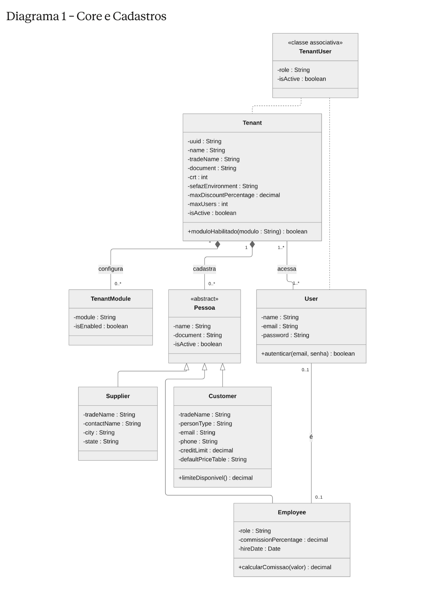
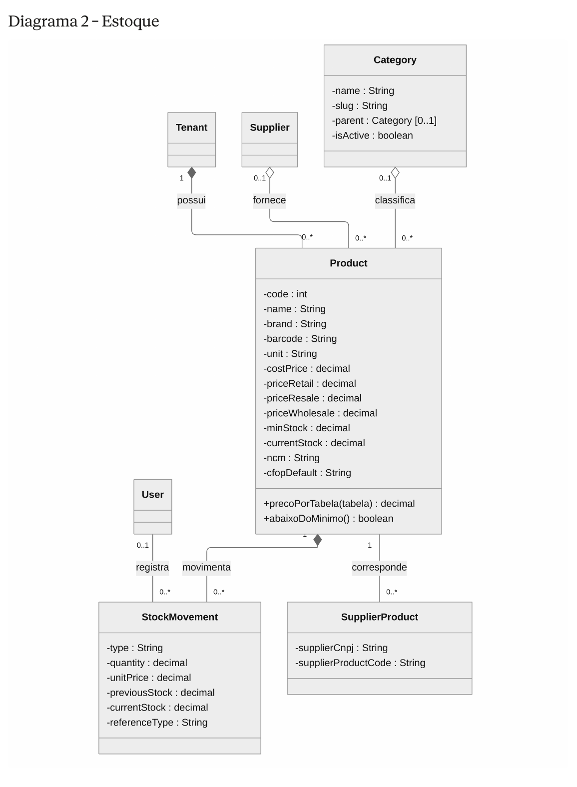
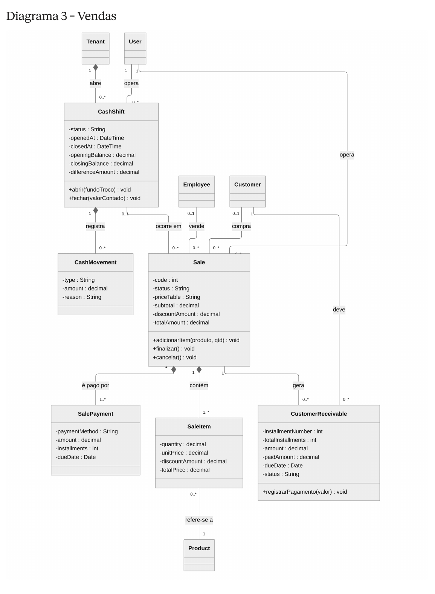

# ESII – Modelagem de Classes – MERP

## Visão geral

O sistema modelado é o **MERP**, nosso Projeto Integrador: um ERP multiempresa (*multi-tenant*) com módulos de **Core**, **Cadastros**, **Estoque** e **Vendas (PDV)**. Cada empresa cliente é um `Tenant` e todos os dados do sistema pertencem a uma empresa.

## Diagramas de classes

Para facilitar a leitura, o diagrama foi dividido por módulo. As classes que aparecem somente com o nome, sem atributos, pertencem a outro módulo e estão detalhadas no respectivo diagrama.

### Diagrama 1 – Core e Cadastros

### Diagrama 2 – Estoque

### Diagrama 3 – Vendas

## Classes identificadas

> Nos diagramas UML, os atributos estão indicados como privados (`-`) e as operações como públicas (`+`). Abaixo, os membros estão organizados por classe para facilitar a consulta.

### Módulo Core

#### `Tenant`
Empresa cliente do sistema. Guarda os dados cadastrais e as configurações gerais da empresa.

| Atributo | Tipo |
|---|---|
| `uuid` | `String` |
| `name` | `String` |
| `tradeName` | `String` |
| `document` | `String` |
| `crt` | `int` |
| `sefazEnvironment` | `String` |
| `maxDiscountPercentage` | `decimal` |
| `maxUsers` | `int` |
| `isActive` | `boolean` |

**Método:** `moduloHabilitado(modulo: String): boolean` – verifica se a empresa tem acesso a um módulo.

#### `TenantModule`
Representa os módulos liberados para cada empresa, como Estoque, Vendas e Fiscal.

| Atributo | Tipo |
|---|---|
| `module` | `String` |
| `isEnabled` | `boolean` |

#### `User`
Representa o login de acesso ao sistema.

| Atributo | Tipo |
|---|---|
| `name` | `String` |
| `email` | `String` |
| `password` | `String` |

**Método:** `autenticar(email, senha): boolean` – valida o acesso.

#### `TenantUser` – classe associativa
Liga um usuário à empresa e guarda o papel dele naquela empresa (`admin`, `gerente`, `operador`) e se o vínculo está ativo. Um mesmo usuário pode acessar mais de uma empresa.

| Atributo | Tipo |
|---|---|
| `role` | `String` |
| `isActive` | `boolean` |

### Módulo Cadastros

#### `Pessoa` – classe abstrata
Reúne os dados comuns a clientes, fornecedores e colaboradores.

| Atributo | Tipo |
|---|---|
| `name` | `String` |
| `document` | `String` |
| `isActive` | `boolean` |

#### `Customer` – cliente
Representa uma pessoa física ou jurídica cadastrada como cliente.

| Atributo | Tipo |
|---|---|
| `tradeName` | `String` |
| `personType` | `String` |
| `email` | `String` |
| `phone` | `String` |
| `creditLimit` | `decimal` |
| `defaultPriceTable` | `String` |

**Método:** `limiteDisponivel(): decimal` – calcula quanto o cliente ainda pode comprar a prazo.

#### `Supplier` – fornecedor
Representa o fornecedor cadastrado na empresa.

| Atributo | Tipo |
|---|---|
| `tradeName` | `String` |
| `contactName` | `String` |
| `city` | `String` |
| `state` | `String` |

#### `Employee` – colaborador
Representa o colaborador, que pode ou não ter um login no sistema.

| Atributo | Tipo |
|---|---|
| `role` | `String` |
| `commissionPercentage` | `decimal` |
| `hireDate` | `Date` |

**Método:** `calcularComissao(valor): decimal` – calcula a comissão sobre uma venda.

### Módulo Estoque

#### `Category` – categoria
Organiza os produtos por categorias e permite a criação de subcategorias por meio do atributo `parent`.

| Atributo | Tipo |
|---|---|
| `name` | `String` |
| `slug` | `String` |
| `parent` | `Category [0..1]` |
| `isActive` | `boolean` |

#### `Product` – produto
Armazena os dados cadastrais, comerciais, de estoque e fiscais do produto.

| Atributo | Tipo |
|---|---|
| `code` | `int` |
| `name` | `String` |
| `brand` | `String` |
| `barcode` | `String` |
| `unit` | `String` |
| `costPrice` | `decimal` |
| `priceRetail` | `decimal` |
| `priceResale` | `decimal` |
| `priceWholesale` | `decimal` |
| `minStock` | `decimal` |
| `currentStock` | `decimal` |
| `ncm` | `String` |
| `cfopDefault` | `String` |

**Métodos:**
- `precoPorTabela(tabela): decimal` – retorna o preço da tabela escolhida.
- `abaixoDoMinimo(): boolean` – informa se o estoque está abaixo do mínimo.

#### `StockMovement` – movimentação de estoque
Representa o Kardex do produto, registrando entradas, saídas, ajustes e perdas, além da origem da movimentação.

| Atributo | Tipo |
|---|---|
| `type` | `String` |
| `quantity` | `decimal` |
| `unitPrice` | `decimal` |
| `previousStock` | `decimal` |
| `currentStock` | `decimal` |
| `referenceType` | `String` |

#### `SupplierProduct`
Faz o relacionamento entre o código do produto no XML da nota do fornecedor e o produto interno, sendo utilizado na importação de notas.

| Atributo | Tipo |
|---|---|
| `supplierCnpj` | `String` |
| `supplierProductCode` | `String` |

### Módulo Vendas

#### `Sale` – venda
Armazena os dados e os valores da venda. Possui operações para adicionar itens, finalizar e cancelar a venda.

| Atributo | Tipo |
|---|---|
| `code` | `int` |
| `status` | `String` |
| `priceTable` | `String` |
| `subtotal` | `decimal` |
| `discountAmount` | `decimal` |
| `totalAmount` | `decimal` |

**Métodos:**
- `adicionarItem(produto, qtd): void`
- `finalizar(): void`
- `cancelar(): void`

#### `SaleItem` – item da venda
Representa cada item incluído em uma venda.

| Atributo | Tipo |
|---|---|
| `quantity` | `decimal` |
| `unitPrice` | `decimal` |
| `discountAmount` | `decimal` |
| `totalPrice` | `decimal` |

#### `SalePayment` – pagamento da venda
Registra uma forma de pagamento utilizada para quitar uma venda. Uma venda pode utilizar mais de uma forma de pagamento.

| Atributo | Tipo |
|---|---|
| `paymentMethod` | `String` |
| `amount` | `decimal` |
| `installments` | `int` |
| `dueDate` | `Date` |

#### `CashShift` – turno de caixa
Representa o turno de caixa, incluindo abertura, fechamento, fundo de troco, valor contado e eventual diferença (sobra ou quebra).

| Atributo | Tipo |
|---|---|
| `status` | `String` |
| `openedAt` | `DateTime` |
| `closedAt` | `DateTime` |
| `openingBalance` | `decimal` |
| `closingBalance` | `decimal` |
| `differenceAmount` | `decimal` |

**Métodos:**
- `abrir(fundoTroco): void`
- `fechar(valorContado): void`

#### `CashMovement` – movimentação de caixa
Registra sangrias e suprimentos realizados no turno de caixa, com o valor e o motivo.

| Atributo | Tipo |
|---|---|
| `type` | `String` |
| `amount` | `decimal` |
| `reason` | `String` |

#### `CustomerReceivable` – conta a receber
Representa as parcelas do crediário. O método `registrarPagamento()` dá baixa na parcela.

| Atributo | Tipo |
|---|---|
| `installmentNumber` | `int` |
| `totalInstallments` | `int` |
| `amount` | `decimal` |
| `paidAmount` | `decimal` |
| `dueDate` | `Date` |
| `status` | `String` |

**Método:** `registrarPagamento(valor): void`

## Relacionamentos e multiplicidades

### Generalização

`Customer`, `Supplier` e `Employee` herdam de `Pessoa`, pois compartilham nome, documento e status de ativo, enquanto cada classe especializada acrescenta seus próprios dados.

### Composição

Na composição, a parte depende do elemento composto para existir, conforme descrito no modelo.

| Relacionamento | Descrição |
|---|---|
| `Tenant (1) – TenantModule (0..*)` | Os módulos liberados só existem para a empresa que os configurou. |
| `Tenant (1) – Pessoa (0..*)` | Clientes, fornecedores e colaboradores pertencem a uma empresa e são removidos junto com ela. |
| `Tenant (1) – Product (0..*)` | Todo produto pertence a uma empresa. |
| `Tenant (1) – CashShift (0..*)` | Os turnos de caixa são abertos dentro de uma empresa. |
| `Product (1) – StockMovement (0..*)` | A movimentação de estoque não existe sem o produto. |
| `Sale (1) – SaleItem (1..*)` | Uma venda tem pelo menos um item, e o item não existe fora da venda. |
| `Sale (1) – SalePayment (1..*)` | Uma venda é paga por uma ou mais formas de pagamento. |
| `CashShift (1) – CashMovement (0..*)` | Sangrias e suprimentos só existem dentro de um turno de caixa. |

### Agregação

| Relacionamento | Descrição |
|---|---|
| `Category (0..1) – Product (0..*)` | A categoria agrupa produtos, mas o produto continua existindo se a categoria for removida. |
| `Supplier (0..1) – Product (0..*)` | O fornecedor principal fornece vários produtos, mas o produto existe independentemente dele. |

### Associação

| Relacionamento | Descrição |
|---|---|
| `Tenant (1..*) – User (1..*)`, por meio de `TenantUser` | Um usuário pode acessar várias empresas e uma empresa tem vários usuários. O papel (`role`) fica na ligação, pois o mesmo usuário pode ser administrador em uma empresa e operador em outra. |
| `User (0..1) – Employee (0..1)` | Um colaborador pode ter um login no sistema, mas isso não é obrigatório. |
| `Category (0..1) – Category (0..*)` | Autorrelacionamento: uma categoria pode ter uma categoria pai, formando subcategorias pelo atributo `parent`. |
| `Product (1) – SupplierProduct (0..*)` | Um produto pode ter vários códigos de fornecedores diferentes. |
| `User (0..1) – StockMovement (0..*)` | Identifica o usuário que registrou a movimentação. |
| `User (1) – CashShift (0..*)` | Identifica o operador que abriu o turno de caixa. |
| `CashShift (0..1) – Sale (0..*)` | A venda acontece dentro de um turno de caixa. |
| `User (1) – Sale (0..*)` | Identifica o operador de caixa que realizou a venda. |
| `Employee (0..1) – Sale (0..*)` | Identifica o vendedor que recebe a comissão. |
| `Customer (0..1) – Sale (0..*)` | O cliente é opcional na venda, permitindo uma venda de balcão sem identificação. |
| `SaleItem (0..*) – Product (1)` | Cada item da venda se refere a um produto. |
| `Sale (1) – CustomerReceivable (0..*)` | Uma venda a prazo gera as parcelas a receber. |
| `Customer (1) – CustomerReceivable (0..*)` | As parcelas ficam vinculadas ao cliente. |
