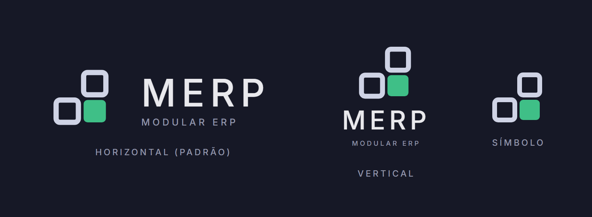
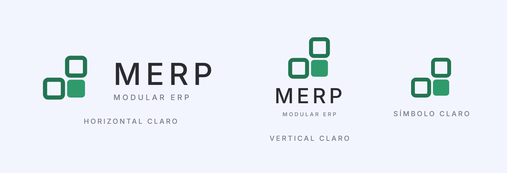
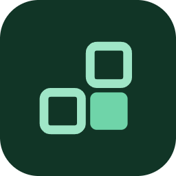
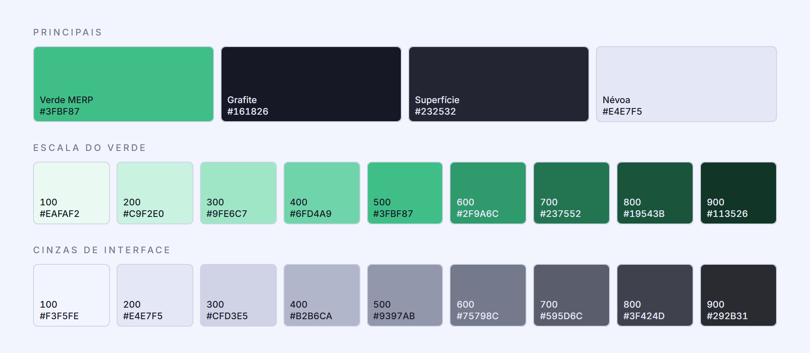
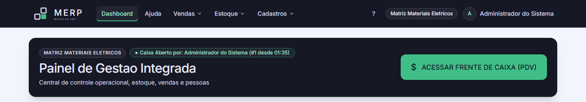
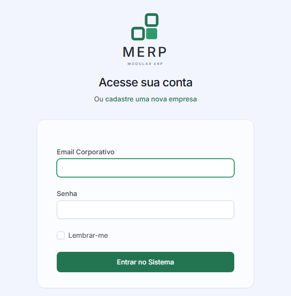
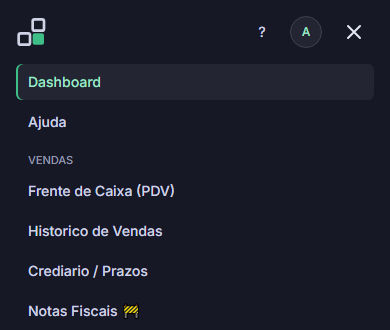

# Identidade Visual — MERP

Documentação da marca do sistema. O ERP-FATEC usa a identidade **MERP** (Modular ERP), versão
1.0, aplicada em todas as telas: login, painel, PDV, estoque e cadastros.

<p align="center"></p>

## O conceito

O MERP é um ERP modular para controle de vendas e estoque. O símbolo traduz isso de forma
literal: **três blocos de mesmo tamanho em degrau, um deles preenchido em verde**.

- Cada bloco é um **módulo**: existe por conta própria, ocupa a mesma grade e cresce na mesma
  direção, como os módulos Estoque, Vendas e Cadastros do sistema.
- O bloco verde é o **módulo ativo**, aquele em que o usuário está trabalhando.
- A folga entre os blocos faz parte da marca: é o que separa um módulo do outro. Os blocos nunca
  se encostam.

Tom da comunicação: corporativo e confiável, direto, sem exclamação e sem jargão de venda.

## Versões do logo

<p align="center"></p>

| Versão | Arquivo | Onde é usada |
|---|---|---|
| Horizontal | `merp-horizontal.svg` | Padrão. Barra superior do sistema (fundo grafite). |
| Horizontal claro | `merp-horizontal-claro.svg` | A mesma assinatura sobre fundo claro. Tela de cadastro de empresa. |
| Vertical | `merp-vertical.svg` / `merp-vertical-claro.svg` | Espaços estreitos. Tela de login. |
| Símbolo | `merp-simbolo.svg` / `merp-simbolo-claro.svg` | Menu recolhido (celular) e avatar. |
| Ícone de app | `merp-icone-app.svg` | Ícone de aplicativo. É a única versão com fundo próprio (verde 900). |
| Favicon | `merp-favicon-32/64/180.png` | Aba do navegador. |

<p align="center"> &nbsp;&nbsp;
</p>

## Construção e respiro

| Regra | Valor |
|---|---|
| Grade do símbolo | 48 × 48 |
| Bloco | 17 unidades, cantos com raio 3 |
| Folga entre blocos | 4 unidades |
| Respiro mínimo | a largura de um bloco (35% da altura do símbolo) em todos os lados |
| Tamanho mínimo do símbolo isolado | 24 px de altura |
| Tamanho mínimo na assinatura horizontal | 18 px de altura do símbolo |

## Cores

<p align="center"></p>

| Nome | HEX | Uso |
|---|---|---|
| **Verde MERP** | `#3FBF87` | Primária: acentos, módulo ativo, bloco do símbolo |
| **Grafite** | `#161826` | Fundo da barra superior e de áreas escuras |
| **Superfície** | `#232532` | Cartões e itens destacados sobre o grafite |
| **Névoa** | `#E4E7F5` | Texto sobre o grafite; fundo claro |

Regras de uso:

- Verde só em linhas, ícones, marcas curtas e estados ativos. **Áreas grandes nunca são verdes.**
- Sobre fundo claro, usa-se o verde 600 ou 700.
- Texto corrido em verde sobre o grafite usa o tom 300.
- Não se usa preto nem branco puros, só os extremos das escalas.

## Tipografia

Família única: **Inter** (Google Fonts, licença SIL Open Font License), só nos pesos
**Regular 400** e **Medium 500**. A hierarquia vem do tamanho e do espaço, não do peso: títulos
param no 500.

| Estilo | Peso | Tamanho / entrelinha |
|---|---|---|
| Título | Medium 500 | 33 / 40 px |
| Subtítulo | Medium 500 | 21 / 28 px |
| Corpo | Regular 400 | 15 / 26 px |
| Etiqueta | Medium 500 | 11 px, caixa alta, entreletra 0,22em |
| Números | Medium 500 | `font-variant-numeric: tabular-nums` |

No logotipo, a palavra MERP é Inter Medium 500 em caixa alta com entreletra 0,15em. O
descritivo MODULAR ERP usa entreletra 0,28em, em cinza 500.

## A marca no sistema

<p align="center"></p>

- **Barra superior** em grafite com o logo horizontal. O item de menu ativo fica em verde 300
  sobre a superfície, com uma linha verde embaixo.
- **Área de conteúdo** clara (cinza 100 `#F3F5FE`), com cartões quase brancos.
- **Login** com o logo vertical, e **cadastro de empresa** com o horizontal claro.
- **Celular:** com o menu recolhido, a barra mostra só o símbolo.

<p align="center"> &nbsp;&nbsp;
</p>

### Onde está no código

| Arquivo | O que faz |
|---|---|
| `public/brand/merp/` | Logos (SVG e PNG), favicons e ícone de app |
| `Modules/Core/resources/views/components/brand/head.blade.php` | Fonte Inter, favicons e a paleta configurada no Tailwind |
| `Modules/Core/resources/views/components/brand/logo.blade.php` | Componente `<x-core::brand.logo variante="..." />` |
| `Modules/Core/resources/views/components/brand/favicons.blade.php` | Favicons, usados também nas páginas de impressão |
| `Modules/Core/resources/views/components/layouts/master.blade.php` | Layout principal com a barra em grafite |

Exemplo de uso do logo numa tela:

```blade
<x-core::brand.logo variante="vertical-claro" class="mx-auto h-32 w-auto" />
```

O logo é inserido como SVG direto no HTML, e não como ``. Dentro de um `` o navegador
não aplica a fonte Inter da página, e o texto "MERP" sairia em Arial.

### Decisões de aplicação

- **Botões em verde 700 (`#237552`).** Com texto claro, o verde 600 dá contraste de 3,5:1, abaixo
  do mínimo recomendado para texto pequeno (4,5:1). O verde 700 dá 5,6:1. O guia permite 600 ou
  700 sobre fundo claro.
- **Cinzas pela luminosidade.** Os tons médios da escala MERP são mais claros que os do Tailwind
  (a biblioteca de CSS do sistema). Por isso cada cinza do sistema foi trocado pelo tom MERP de
  claridade parecida, e não pelo de mesmo número, para não perder contraste no texto
  secundário.
- **Cor da empresa.** A cor padrão de cada empresa passou a ser o verde MERP. Quem ainda tinha a
  cor antiga (índigo `#4f46e5`) gravada passa a ver o verde automaticamente.
- **Admin Supremo** mantém o destaque âmbar, para não ser confundido com a tela de uma empresa.

## Faça e não faça

| Faça | Não faça |
|---|---|
| Mantenha a folga entre os blocos | Girar, inclinar ou aplicar perspectiva no símbolo |
| Use a assinatura horizontal como padrão | Trocar a cor do bloco ativo por outra que não o verde |
| Deixe o verde nos acentos e estados ativos | Aplicar gradiente, sombra ou contorno ao logotipo |
| Sobre fundo claro, use a versão claro (verde 600/700) | Usar a marca sobre foto sem uma área de cor uniforme |
| Alinhe a marca à esquerda, junto à margem | Engordar o texto MERP acima do peso 500 |
