# Stored Procedures

Documentação das stored procedures (procedimentos armazenados) do banco de dados do ERP-FATEC. O
sistema possui **17 stored procedures**, todas no banco MySQL/MariaDB, criadas por três migrations:

| Migration | Procedures |
|---|---|
| `database/migrations/2026_10_19_000000_create_stored_procedures.php` | 4 — relatórios de vendas, inadimplência e ajuste de estoque |
| `Modules/Estoque/database/migrations/2026_10_26_100000_create_estoque_procedures.php` | 10 — consulta, inserção, atualização e exclusão de produtos |
| `Modules/Vendas/database/migrations/2026_10_26_100001_create_vendas_procedures.php` | 3 — comissão, resumo de caixa e crediário |

## O que é uma stored procedure

Uma stored procedure é um bloco de comandos SQL salvo no banco com um nome, que pode receber
**parâmetros de entrada** (`IN`), devolver **parâmetros de saída** (`OUT`) e retornar o resultado
de consultas. É executada com `CALL nome_da_procedure(...)`.

Diferente de uma view, que é só um `SELECT` salvo, a procedure pode ter **lógica**: variáveis,
condições (`IF`), validações com mensagem de erro (`SIGNAL`), alterações de dados (`UPDATE`,
`INSERT`) e **transações** (`START TRANSACTION`, `COMMIT`, `ROLLBACK`).

Com parâmetros, a mesma procedure serve para valores diferentes: `CALL sp_produto_por_id(1, 4)` e
`CALL sp_produto_por_id(1, 8)` executam o mesmo código, mudando só o produto buscado. Sem
parâmetros, seria preciso uma procedure (ou uma consulta escrita à mão) para cada valor.

## Vantagens

| Vantagem | Como aparece no ERP-FATEC |
|---|---|
| **Regra num lugar só** | O ajuste de estoque e o kardex ficam juntos numa procedure; quem chama não esquece de gravar o movimento. A margem de lucro é recalculada pela própria procedure que muda o preço. |
| **Parâmetros** | Os relatórios recebem empresa, período e limite, em vez de reescrever a consulta para cada caso. |
| **Integridade** | O ajuste roda numa transação e trava a linha do produto: dois ajustes ao mesmo tempo não se atropelam, e um erro desfaz tudo. |
| **Validação no banco** | Saída maior que o saldo, NCM inválido, faixa de preço invertida ou produto de outra empresa são recusados pelo próprio banco, com mensagem clara. |
| **Segurança** | Nenhum SQL é montado por concatenação: até a ordenação escolhida pelo usuário passa por uma lista fechada de campos. |

## Regras seguidas pelas procedures

| Regra | Como aparece no código |
|---|---|
| **Multi-empresa** | Todas recebem a empresa (`p_tenant_id`) como primeiro parâmetro e filtram por `tenant_id`. Uma empresa nunca lê nem altera dados de outra. |
| **Exclusão lógica** | Consultas ignoram registros com `deleted_at` preenchido; excluir produto faz `UPDATE deleted_at`, nunca `DELETE`. |
| **Tipos reais das colunas** | IDs `BIGINT UNSIGNED`, valores `DECIMAL(12,2)`, estoque `DECIMAL(12,3)` — iguais às colunas das tabelas. |
| **Erros claros** | Valor inválido gera erro com `SIGNAL SQLSTATE '45000'` e mensagem em português. |
| **Vendas concluídas** | Os relatórios consideram só vendas com `status = 'completed'`; canceladas ficam de fora. |
| **Período inclusivo** | Nas datas de início e fim, o dia final inteiro entra (`'2026-10-31'` inclui o dia 31 até 23:59). |

## Procedures do sistema

| Procedure | Parâmetros | Finalidade | Tipo |
|---|---|---|---|
| `sp_produto_por_id` | empresa, produto | Um produto pelo ID, com a categoria | Consulta |
| `sp_pdv_buscar_produto` | empresa, termo | Busca do PDV por código, código de barras, SKU ou nome | Consulta |
| `sp_produtos_por_categoria` | empresa, categoria | Produtos ativos de uma categoria | Consulta |
| `sp_produtos_por_faixa_preco` | empresa, mínimo, máximo, tabela | Produtos entre dois preços, na tabela de preço escolhida | Consulta |
| `sp_listar_produtos_ordenados` | empresa, campo, direção | Produtos ordenados por nome, preço, estoque ou código | Consulta |
| `sp_produtos_abaixo_estoque_minimo` | empresa | O que precisa ser reposto | Consulta |
| `sp_kardex_produto` | empresa, produto, início, fim | Extrato de estoque de um produto no período | Consulta |
| `sp_inserir_produto` | empresa, categoria, nome, unidade, NCM, custo, preço, mínimo | Cadastra um produto | Inserção |
| `sp_atualizar_preco_produto` | empresa, produto, preço | Muda o preço de varejo e recalcula a margem | Atualização |
| `sp_excluir_produto` | empresa, produto | Exclusão lógica de um produto | Exclusão |
| `sp_vendas_por_periodo` | empresa, início, fim | Quantidade de vendas, total vendido, ticket médio e descontos | Consulta |
| `sp_produtos_mais_vendidos` | empresa, início, fim, limite | Ranking dos produtos por quantidade vendida | Consulta |
| `sp_comissao_vendedores` | empresa, início, fim | Comissão de cada vendedor no período | Consulta |
| `sp_resumo_caixa` | empresa, turno de caixa | Fechamento de um turno de caixa | Consulta |
| `sp_contas_receber_cliente` | empresa, cliente | Parcelas em aberto do crediário de um cliente | Consulta |
| `sp_clientes_inadimplentes` | empresa, dias | Clientes com títulos vencidos há mais de N dias | Consulta |
| `sp_ajustar_estoque` | empresa, produto, quantidade, motivo, usuário, **saída: novo saldo** | Entrada ou saída de estoque com registro no kardex | Alteração com transação |

## Mapa da lista de exercícios

| Exercício | Pede | Procedure |
|---|---|---|
| 7 | Buscar pelo ID da tabela principal | `sp_produto_por_id` |
| 8 | Pesquisar pelo nome | `sp_pdv_buscar_produto` |
| 9 | Filtrar por categoria | `sp_produtos_por_categoria` |
| 10 | Inserir com parâmetros | `sp_inserir_produto` |
| 11 | Atualizar um campo | `sp_atualizar_preco_produto` |
| 12 | Excluir pelo ID | `sp_excluir_produto` (exclusão lógica) |
| 13 | Dois parâmetros no `WHERE` | `sp_contas_receber_cliente`, `sp_produtos_por_faixa_preco` |
| 14 | Faixa de valores | `sp_produtos_por_faixa_preco` |
| 15 | Filtro por data | `sp_vendas_por_periodo`, `sp_kardex_produto` |
| 16 | Ordenar por campo escolhido | `sp_listar_produtos_ordenados` |
| 17 a 23 | Executar com valores diferentes, inexistentes e inválidos | Prints de cada procedure, abaixo |
| 30 | Operações candidatas a procedure | `sp_produtos_abaixo_estoque_minimo`, `sp_produtos_mais_vendidos`, `sp_comissao_vendedores`, `sp_resumo_caixa`, `sp_kardex_produto`, `sp_ajustar_estoque` |

## Dados usados nos exemplos

Os prints abaixo foram tirados em 26/10/2026 no cliente de linha de comando do **MariaDB 11.4.5**,
num banco criado do zero com `php artisan migrate --seed` (os mesmos dados de exemplo da
[Views](Views)). Como o seeder não cria vendas, foram lançadas pelo próprio sistema
(`SaleService`), na empresa 1, num turno de caixa aberto com R$ 200,00 de fundo de troco,
R$ 50,00 de suprimento e R$ 100,00 de sangria:

| Venda | Itens | Pagamento | Vendedor |
|---|---|---|---|
| #1 | 2 Cabos Flexíveis 2,5mm² = R$ 420,50 | Dinheiro, cliente entregou R$ 450,00 (troco R$ 29,50) | Maria Santos |
| #2 | 10 Tomadas + 5 Interruptores = R$ 150,40 | PIX | Ana Oliveira |
| #3 | 3 Disjuntores 40A + 1 Quadro = R$ 202,94 | A prazo, 2x, para Instalações Elétricas Rio (1ª parcela em 26/09/2026) | Maria Santos |
| #4 | 20 Fitas Isolantes = R$ 138,60 | Cartão de crédito | — |

Empresa **1** é a "Empresa Matriz Servicos e Comercio LTDA" (dona dos produtos); empresa **2** é
usada para mostrar o isolamento entre empresas. As procedures foram executadas na ordem desta
página, então as alterações feitas por uma (inserção, novo preço, exclusão) aparecem nas
seguintes. Datas e horas gravadas pelo sistema aparecem em UTC (3 horas a mais que o horário de
Brasília). Os mesmos prints estão na pasta `fotosMySQL/` do projeto.

---

## Consultas de produto

### sp_produto_por_id

Busca um produto pelo ID, com o nome da categoria (exercício 7). Executada com três IDs diferentes
e com um produto de outra empresa: o produto 1 existe, mas pertence à empresa 1, então a empresa 2
recebe `Empty set` — a consulta roda sem erro e não devolve linhas.

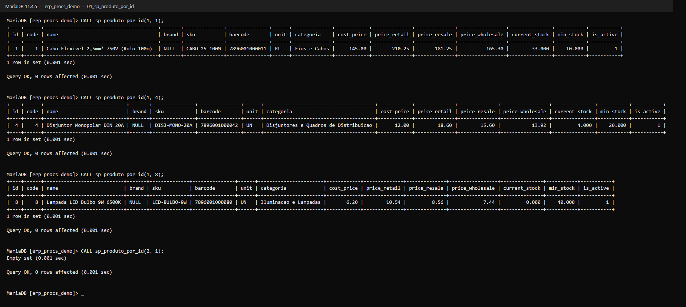

<details>
<summary>Código SQL</summary>

```sql
DELIMITER $$
CREATE PROCEDURE sp_produto_por_id(
    IN p_tenant_id BIGINT UNSIGNED,
    IN p_product_id BIGINT UNSIGNED
)
BEGIN
    SELECT p.id, p.code, p.name, p.brand, p.sku, p.barcode, p.unit,
           c.name AS categoria, p.cost_price, p.price_retail, p.price_resale,
           p.price_wholesale, p.current_stock, p.min_stock, p.is_active
    FROM products p
    LEFT JOIN categories c ON c.id = p.category_id AND c.tenant_id = p.tenant_id
    WHERE p.tenant_id = p_tenant_id
      AND p.id = p_product_id
      AND p.deleted_at IS NULL;
END $$
DELIMITER ;
```

</details>

### sp_pdv_buscar_produto

A busca do PDV (exercício 8). Encontra produtos ativos pelo código interno, código de barras ou SKU
exatos, ou por parte do nome; as correspondências exatas vêm primeiro, que é o que o leitor de
código de barras espera. Os curingas do `LIKE` (`%` e `_`) digitados são tratados como texto comum.

O SKU `DISJ-MONO-20A` foi achado digitando `'disj-mono-20a'`: a comparação não diferencia
maiúsculas de minúsculas porque as tabelas usam a collation `utf8mb4_unicode_ci` (o `ci` significa
*case insensitive*). A empresa 2 não enxerga os cabos da empresa 1.

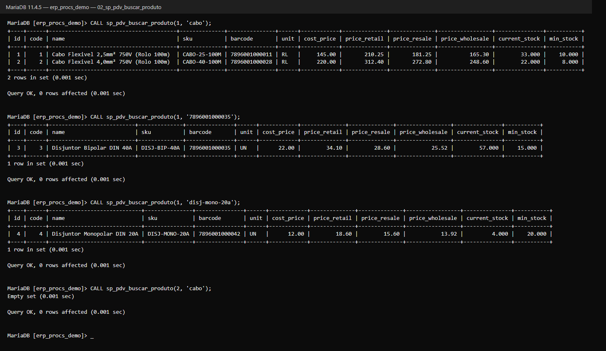

<details>
<summary>Código SQL</summary>

```sql
DELIMITER $$
CREATE PROCEDURE sp_pdv_buscar_produto(
    IN p_tenant_id BIGINT UNSIGNED,
    IN p_termo VARCHAR(255) CHARACTER SET utf8mb4
)
BEGIN
    DECLARE v_termo VARCHAR(255) CHARACTER SET utf8mb4 DEFAULT TRIM(COALESCE(p_termo, ''));
    DECLARE v_padrao VARCHAR(520) CHARACTER SET utf8mb4 DEFAULT CONCAT('%',
        REPLACE(REPLACE(REPLACE(v_termo, '\\', '\\\\'), '%', '\\%'), '_', '\\_'), '%');

    SELECT p.id, p.code, p.name, p.sku, p.barcode, p.unit, p.cost_price,
           p.price_retail, p.price_resale, p.price_wholesale,
           p.current_stock, p.min_stock
    FROM products p
    WHERE p.tenant_id = p_tenant_id
      AND p.deleted_at IS NULL
      AND p.is_active = 1
      AND v_termo <> ''
      AND (
          CAST(p.code AS CHAR) = v_termo COLLATE utf8mb4_unicode_ci
          OR p.barcode = v_termo COLLATE utf8mb4_unicode_ci
          OR p.sku = v_termo COLLATE utf8mb4_unicode_ci
          OR p.name LIKE v_padrao COLLATE utf8mb4_unicode_ci
      )
    ORDER BY
        CASE
            WHEN CAST(p.code AS CHAR) = v_termo COLLATE utf8mb4_unicode_ci
              OR p.barcode = v_termo COLLATE utf8mb4_unicode_ci
              OR p.sku = v_termo COLLATE utf8mb4_unicode_ci THEN 0
            ELSE 1
        END,
        p.name
    LIMIT 50;
END $$
DELIMITER ;
```

</details>

### sp_produtos_por_categoria

Lista os produtos ativos de uma categoria (exercício 9): categoria 2 (Disjuntores e Quadros de
Distribuição) e categoria 4 (Iluminação e Lâmpadas).

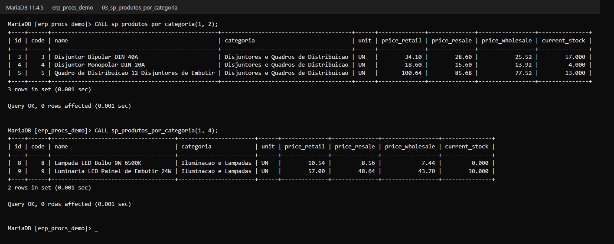

<details>
<summary>Código SQL</summary>

```sql
DELIMITER $$
CREATE PROCEDURE sp_produtos_por_categoria(
    IN p_tenant_id BIGINT UNSIGNED,
    IN p_category_id BIGINT UNSIGNED
)
BEGIN
    SELECT p.id, p.code, p.name, c.name AS categoria, p.unit,
           p.price_retail, p.price_resale, p.price_wholesale, p.current_stock
    FROM products p
    JOIN categories c ON c.id = p.category_id AND c.tenant_id = p.tenant_id
    WHERE p.tenant_id = p_tenant_id
      AND p.category_id = p_category_id
      AND p.deleted_at IS NULL
      AND p.is_active = 1
    ORDER BY p.name;
END $$
DELIMITER ;
```

</details>

### sp_produtos_por_faixa_preco

Produtos com preço entre um mínimo e um máximo (exercícios 13 e 14). O preço vem da tabela
escolhida — `retail` (varejo), `resale` (revenda) ou `wholesale` (atacado); se o produto não tiver
preço de revenda ou atacado, usa o de varejo, a mesma regra de `Product::getPriceForTable`.

Com a mesma faixa, a revenda traz outros produtos: o Disjuntor Bipolar (R$ 34,10 no varejo) entra
porque na revenda sai por R$ 28,60. Faixa invertida é recusada com erro.

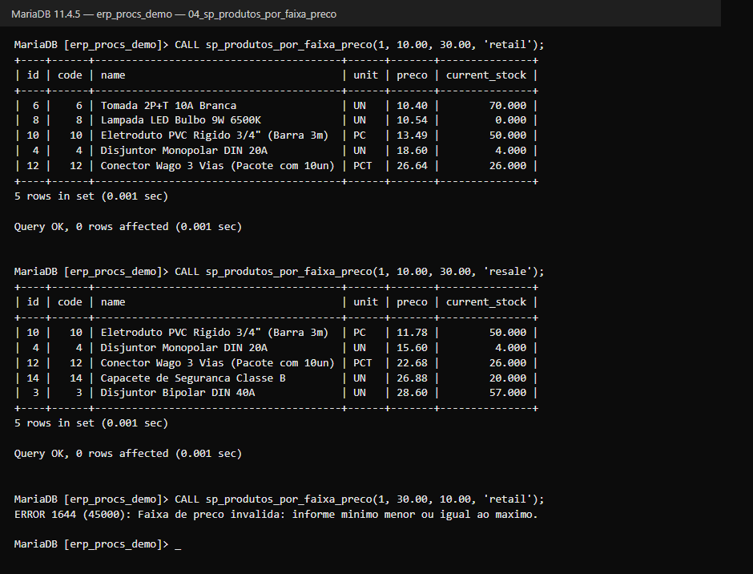

<details>
<summary>Código SQL</summary>

```sql
DELIMITER $$
CREATE PROCEDURE sp_produtos_por_faixa_preco(
    IN p_tenant_id BIGINT UNSIGNED,
    IN p_preco_min DECIMAL(12,2),
    IN p_preco_max DECIMAL(12,2),
    IN p_tabela VARCHAR(10) CHARACTER SET utf8mb4
)
BEGIN
    DECLARE v_tabela VARCHAR(10) CHARACTER SET utf8mb4 DEFAULT LOWER(COALESCE(p_tabela, 'retail'));

    IF v_tabela NOT IN ('retail', 'resale', 'wholesale') THEN
        SIGNAL SQLSTATE '45000'
            SET MESSAGE_TEXT = 'Tabela de preco invalida. Use retail, resale ou wholesale.';
    END IF;

    IF p_preco_min IS NULL OR p_preco_max IS NULL OR p_preco_min > p_preco_max THEN
        SIGNAL SQLSTATE '45000'
            SET MESSAGE_TEXT = 'Faixa de preco invalida: informe minimo menor ou igual ao maximo.';
    END IF;

    SELECT id, code, name, unit, preco, current_stock
    FROM (
        SELECT p.id, p.code, p.name, p.unit, p.current_stock,
               CASE v_tabela
                   WHEN 'resale' THEN IF(COALESCE(p.price_resale, 0) > 0, p.price_resale, p.price_retail)
                   WHEN 'wholesale' THEN IF(COALESCE(p.price_wholesale, 0) > 0, p.price_wholesale, p.price_retail)
                   ELSE p.price_retail
               END AS preco
        FROM products p
        WHERE p.tenant_id = p_tenant_id
          AND p.deleted_at IS NULL
          AND p.is_active = 1
    ) AS precos
    WHERE preco BETWEEN p_preco_min AND p_preco_max
    ORDER BY preco, name;
END $$
DELIMITER ;
```

</details>

### sp_listar_produtos_ordenados

Lista os produtos ativos ordenados pelo campo e pela direção escolhidos (exercício 16): `nome`,
`preco`, `estoque` ou `codigo`, em `ASC` ou `DESC`. O campo não é colado no SQL: um `CASE` por
campo e direção escolhe a coluna, e qualquer valor fora da lista gera erro. Assim não há risco de
SQL injection, e números são ordenados como números (não como texto, em que "100" viria antes de
"20").

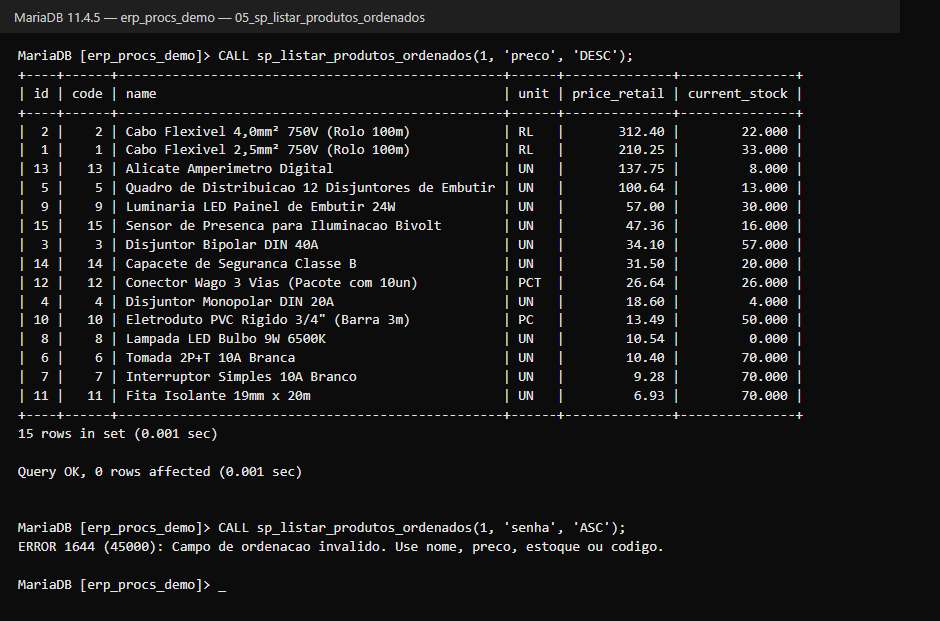

<details>
<summary>Código SQL</summary>

```sql
DELIMITER $$
CREATE PROCEDURE sp_listar_produtos_ordenados(
    IN p_tenant_id BIGINT UNSIGNED,
    IN p_campo VARCHAR(10) CHARACTER SET utf8mb4,
    IN p_direcao VARCHAR(4) CHARACTER SET utf8mb4
)
BEGIN
    DECLARE v_campo VARCHAR(10) CHARACTER SET utf8mb4 DEFAULT LOWER(COALESCE(p_campo, 'nome'));
    DECLARE v_direcao VARCHAR(4) CHARACTER SET utf8mb4 DEFAULT UPPER(COALESCE(p_direcao, 'ASC'));

    IF v_campo NOT IN ('nome', 'preco', 'estoque', 'codigo') THEN
        SIGNAL SQLSTATE '45000'
            SET MESSAGE_TEXT = 'Campo de ordenacao invalido. Use nome, preco, estoque ou codigo.';
    END IF;

    IF v_direcao NOT IN ('ASC', 'DESC') THEN
        SIGNAL SQLSTATE '45000'
            SET MESSAGE_TEXT = 'Direcao invalida. Use ASC ou DESC.';
    END IF;

    SELECT p.id, p.code, p.name, p.unit, p.price_retail, p.current_stock
    FROM products p
    WHERE p.tenant_id = p_tenant_id
      AND p.deleted_at IS NULL
      AND p.is_active = 1
    ORDER BY
        CASE WHEN v_campo = 'nome' AND v_direcao = 'ASC' THEN p.name END ASC,
        CASE WHEN v_campo = 'nome' AND v_direcao = 'DESC' THEN p.name END DESC,
        CASE WHEN v_campo = 'preco' AND v_direcao = 'ASC' THEN p.price_retail END ASC,
        CASE WHEN v_campo = 'preco' AND v_direcao = 'DESC' THEN p.price_retail END DESC,
        CASE WHEN v_campo = 'estoque' AND v_direcao = 'ASC' THEN p.current_stock END ASC,
        CASE WHEN v_campo = 'estoque' AND v_direcao = 'DESC' THEN p.current_stock END DESC,
        CASE WHEN v_campo = 'codigo' AND v_direcao = 'ASC' THEN p.code END ASC,
        CASE WHEN v_campo = 'codigo' AND v_direcao = 'DESC' THEN p.code END DESC,
        p.name;
END $$
DELIMITER ;
```

</details>

### sp_produtos_abaixo_estoque_minimo

O que precisa ser reposto: produtos ativos com estoque mínimo definido e saldo igual ou abaixo
dele, do que mais falta para o que menos falta. É o mesmo critério do sistema
(`Product::isLowStock`). A view `vw_estoque_abaixo_minimo` usa um critério um pouco diferente (só
`<`, e inclui mínimo zero). A empresa 2 não tem produtos.

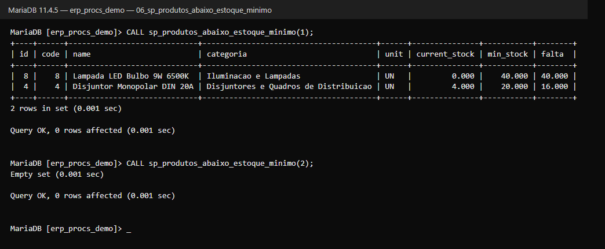

<details>
<summary>Código SQL</summary>

```sql
DELIMITER $$
CREATE PROCEDURE sp_produtos_abaixo_estoque_minimo(
    IN p_tenant_id BIGINT UNSIGNED
)
BEGIN
    SELECT p.id, p.code, p.name, c.name AS categoria, p.unit,
           p.current_stock, p.min_stock,
           (p.min_stock - p.current_stock) AS falta
    FROM products p
    LEFT JOIN categories c ON c.id = p.category_id AND c.tenant_id = p.tenant_id
    WHERE p.tenant_id = p_tenant_id
      AND p.deleted_at IS NULL
      AND p.is_active = 1
      AND p.min_stock > 0
      AND p.current_stock <= p.min_stock
    ORDER BY falta DESC, p.name;
END $$
DELIMITER ;
```

</details>

### sp_kardex_produto

Extrato de estoque (kardex) de um produto num período, com o saldo antes e depois de cada
movimento (exercício 15): a carga inicial do seeder e a saída de cada venda. Período invertido é
recusado com erro.

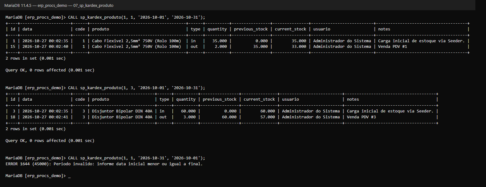

<details>
<summary>Código SQL</summary>

```sql
DELIMITER $$
CREATE PROCEDURE sp_kardex_produto(
    IN p_tenant_id BIGINT UNSIGNED,
    IN p_product_id BIGINT UNSIGNED,
    IN p_data_inicio DATE,
    IN p_data_fim DATE
)
BEGIN
    IF p_data_inicio IS NULL OR p_data_fim IS NULL OR p_data_inicio > p_data_fim THEN
        SIGNAL SQLSTATE '45000'
            SET MESSAGE_TEXT = 'Periodo invalido: informe data inicial menor ou igual a final.';
    END IF;

    SELECT m.id, m.created_at AS data, p.code, p.name AS produto, m.type,
           m.quantity, m.previous_stock, m.current_stock, u.name AS usuario, m.notes
    FROM stock_movements m
    JOIN products p ON p.id = m.product_id AND p.tenant_id = m.tenant_id
    LEFT JOIN users u ON u.id = m.user_id
    WHERE m.tenant_id = p_tenant_id
      AND m.product_id = p_product_id
      AND p.deleted_at IS NULL
      AND m.created_at >= p_data_inicio
      AND m.created_at < p_data_fim + INTERVAL 1 DAY
    ORDER BY m.created_at, m.id;
END $$
DELIMITER ;
```

</details>

---

## Inserção, atualização e exclusão

### sp_inserir_produto

Cadastra um produto (exercício 10). O código interno é o maior código da empresa + 1, como faz o
sistema — cada empresa tem sua própria sequência. A margem de varejo é calculada como na tela de
produto: `(preço ÷ custo − 1) × 100`. Os campos fiscais não informados recebem os valores padrão
da tabela, e o estoque começa em zero (a entrada de mercadoria é feita pelo kardex).

O terceiro produto é da empresa 2 e recebeu o **código 1**: a sequência é por empresa. NCM com
menos de 8 dígitos é recusado e nada é gravado.

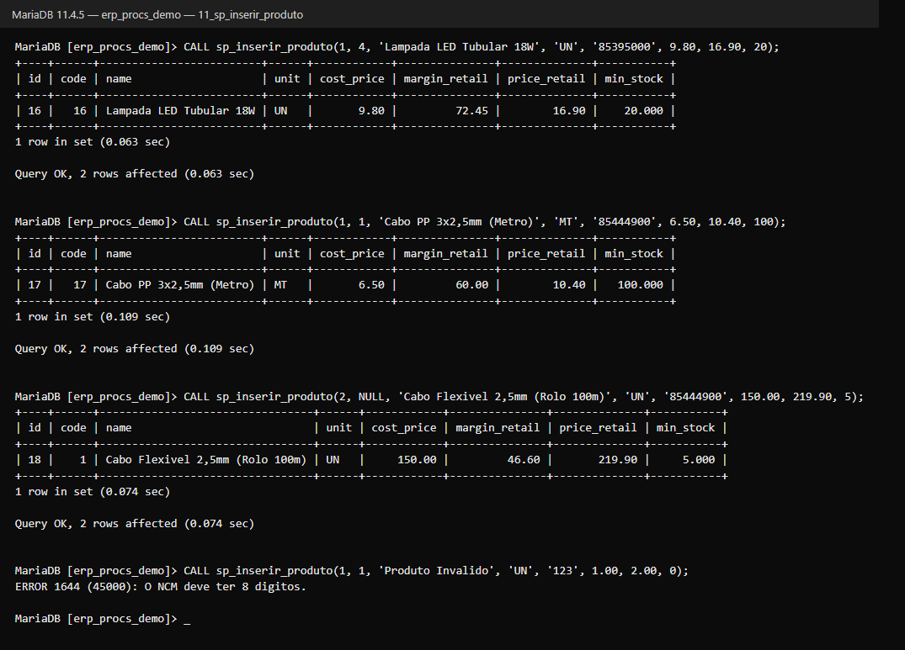

<details>
<summary>Código SQL</summary>

```sql
DELIMITER $$
CREATE PROCEDURE sp_inserir_produto(
    IN p_tenant_id BIGINT UNSIGNED,
    IN p_category_id BIGINT UNSIGNED,
    IN p_name VARCHAR(255) CHARACTER SET utf8mb4,
    IN p_unit VARCHAR(6) CHARACTER SET utf8mb4,
    IN p_ncm VARCHAR(8) CHARACTER SET utf8mb4,
    IN p_cost_price DECIMAL(12,2),
    IN p_price_retail DECIMAL(12,2),
    IN p_min_stock DECIMAL(12,3)
)
BEGIN
    DECLARE v_name VARCHAR(255) CHARACTER SET utf8mb4 DEFAULT TRIM(COALESCE(p_name, ''));
    DECLARE v_cost DECIMAL(12,2) DEFAULT COALESCE(p_cost_price, 0);
    DECLARE v_code BIGINT UNSIGNED;

    IF NOT EXISTS (SELECT 1 FROM tenants WHERE id = p_tenant_id AND deleted_at IS NULL) THEN
        SIGNAL SQLSTATE '45000' SET MESSAGE_TEXT = 'Empresa nao encontrada.';
    END IF;

    IF v_name = '' THEN
        SIGNAL SQLSTATE '45000' SET MESSAGE_TEXT = 'Informe o nome do produto.';
    END IF;

    IF p_ncm IS NULL OR CHAR_LENGTH(p_ncm) <> 8 THEN
        SIGNAL SQLSTATE '45000' SET MESSAGE_TEXT = 'O NCM deve ter 8 digitos.';
    END IF;

    IF p_price_retail IS NULL OR p_price_retail < 0 OR v_cost < 0 THEN
        SIGNAL SQLSTATE '45000' SET MESSAGE_TEXT = 'Precos nao podem ser negativos.';
    END IF;

    IF p_category_id IS NOT NULL AND NOT EXISTS (
        SELECT 1 FROM categories WHERE id = p_category_id AND tenant_id = p_tenant_id
    ) THEN
        SIGNAL SQLSTATE '45000' SET MESSAGE_TEXT = 'Categoria nao pertence a esta empresa.';
    END IF;

    SELECT COALESCE(MAX(code), 0) + 1 INTO v_code
    FROM products
    WHERE tenant_id = p_tenant_id;

    INSERT INTO products (
        tenant_id, code, category_id, name, unit, ncm,
        cost_price, margin_retail, price_retail, min_stock,
        is_active, created_at, updated_at
    ) VALUES (
        p_tenant_id,
        v_code,
        p_category_id,
        v_name,
        COALESCE(NULLIF(TRIM(p_unit), ''), 'UN'),
        p_ncm,
        v_cost,
        IF(v_cost > 0, LEAST(9999.99, GREATEST(-9999.99, ROUND((p_price_retail / v_cost - 1) * 100, 2))), 0),
        p_price_retail,
        COALESCE(p_min_stock, 0),
        1, UTC_TIMESTAMP(), UTC_TIMESTAMP()
    );

    SELECT id, code, name, unit, cost_price, margin_retail, price_retail, min_stock
    FROM products
    WHERE id = LAST_INSERT_ID();
END $$
DELIMITER ;
```

</details>

### sp_atualizar_preco_produto

Altera o preço de varejo de um produto (exercício 11) e recalcula a margem, como faz a tela de
produto. Com custo zero, a margem fica como estava. Na última chamada, a empresa 2 tentou mudar o
preço de um produto da empresa 1: a procedure recusa e o preço continua R$ 210,25.

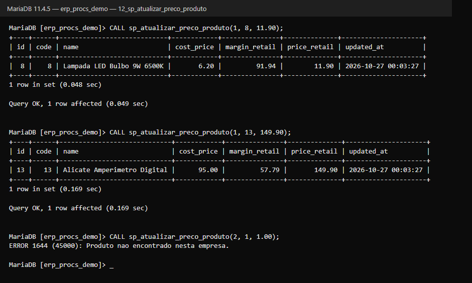

<details>
<summary>Código SQL</summary>

```sql
DELIMITER $$
CREATE PROCEDURE sp_atualizar_preco_produto(
    IN p_tenant_id BIGINT UNSIGNED,
    IN p_product_id BIGINT UNSIGNED,
    IN p_price_retail DECIMAL(12,2)
)
BEGIN
    IF p_price_retail IS NULL OR p_price_retail < 0 THEN
        SIGNAL SQLSTATE '45000' SET MESSAGE_TEXT = 'O preco nao pode ser negativo.';
    END IF;

    IF NOT EXISTS (
        SELECT 1 FROM products
        WHERE tenant_id = p_tenant_id AND id = p_product_id AND deleted_at IS NULL
    ) THEN
        SIGNAL SQLSTATE '45000' SET MESSAGE_TEXT = 'Produto nao encontrado nesta empresa.';
    END IF;

    UPDATE products
    SET margin_retail = IF(cost_price > 0,
            LEAST(9999.99, GREATEST(-9999.99, ROUND((p_price_retail / cost_price - 1) * 100, 2))),
            margin_retail),
        price_retail = p_price_retail,
        updated_at = UTC_TIMESTAMP()
    WHERE tenant_id = p_tenant_id
      AND id = p_product_id
      AND deleted_at IS NULL;

    SELECT id, code, name, cost_price, margin_retail, price_retail, updated_at
    FROM products
    WHERE tenant_id = p_tenant_id AND id = p_product_id;
END $$
DELIMITER ;
```

</details>

### sp_excluir_produto

Exclui um produto pelo ID (exercício 12). A exclusão é **lógica**: a procedure preenche
`deleted_at` em vez de apagar a linha. O produto some de todas as consultas, mas as vendas e o
kardex que apontam para ele continuam íntegros — um `DELETE` físico quebraria o histórico (e seria
barrado pela chave estrangeira de `sale_items`).

No print, o "Cabo PP" cadastrado acima é excluído, some do `sp_produto_por_id`, continua na tabela
com `deleted_at` preenchido, e uma segunda exclusão é recusada.

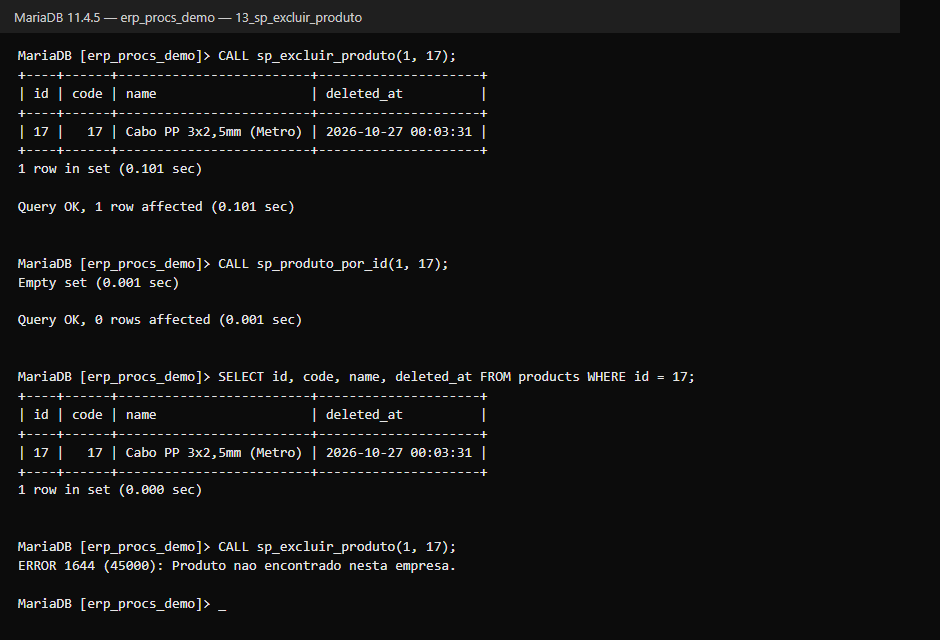

<details>
<summary>Código SQL</summary>

```sql
DELIMITER $$
CREATE PROCEDURE sp_excluir_produto(
    IN p_tenant_id BIGINT UNSIGNED,
    IN p_product_id BIGINT UNSIGNED
)
BEGIN
    IF NOT EXISTS (
        SELECT 1 FROM products
        WHERE tenant_id = p_tenant_id AND id = p_product_id AND deleted_at IS NULL
    ) THEN
        SIGNAL SQLSTATE '45000' SET MESSAGE_TEXT = 'Produto nao encontrado nesta empresa.';
    END IF;

    UPDATE products
    SET deleted_at = UTC_TIMESTAMP(), updated_at = UTC_TIMESTAMP()
    WHERE tenant_id = p_tenant_id
      AND id = p_product_id
      AND deleted_at IS NULL;

    SELECT id, code, name, deleted_at
    FROM products
    WHERE tenant_id = p_tenant_id AND id = p_product_id;
END $$
DELIMITER ;
```

</details>

---

## Relatórios de vendas e crediário

### sp_vendas_por_periodo

Resumo das vendas concluídas de uma empresa num período. Em setembro não houve vendas, e a
empresa 2 não vendeu nada: as duas chamadas devolvem uma linha zerada.

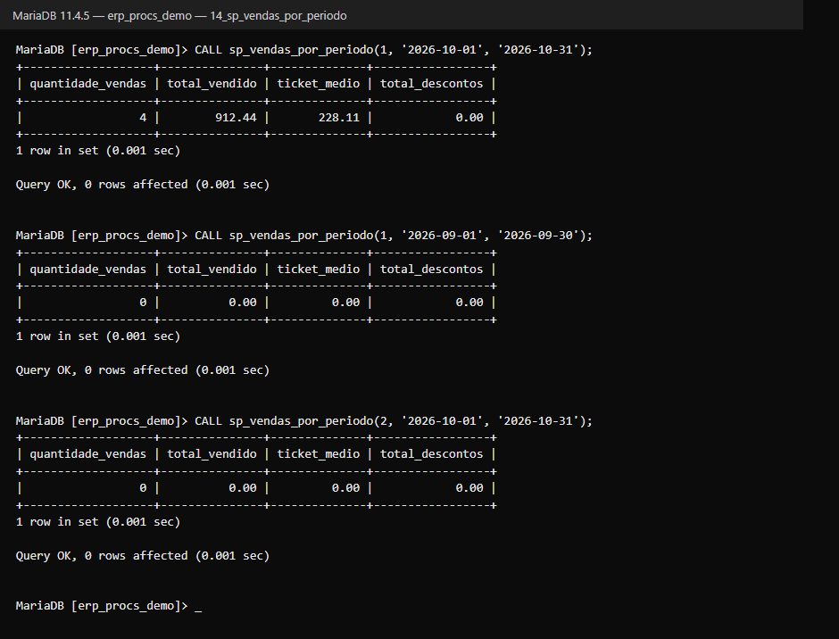

<details>
<summary>Código SQL</summary>

```sql
DELIMITER $$
CREATE PROCEDURE sp_vendas_por_periodo(
    IN p_tenant_id BIGINT UNSIGNED,
    IN p_inicio DATE,
    IN p_fim DATE
)
BEGIN
    SELECT
        COUNT(*) AS quantidade_vendas,
        COALESCE(SUM(v.total_amount), 0) AS total_vendido,
        COALESCE(ROUND(AVG(v.total_amount), 2), 0) AS ticket_medio,
        COALESCE(SUM(v.discount_amount), 0) AS total_descontos
    FROM sales v
    WHERE v.tenant_id = p_tenant_id
      AND v.status = 'completed'
      AND v.created_at >= p_inicio
      AND v.created_at < DATE_ADD(p_fim, INTERVAL 1 DAY);
END $$
DELIMITER ;
```

</details>

### sp_produtos_mais_vendidos

Ranking dos produtos mais vendidos no período, do maior para o menor (por quantidade e, no empate,
por faturamento). O último parâmetro é quantos produtos mostrar; se vier vazio ou zero, mostra 10.

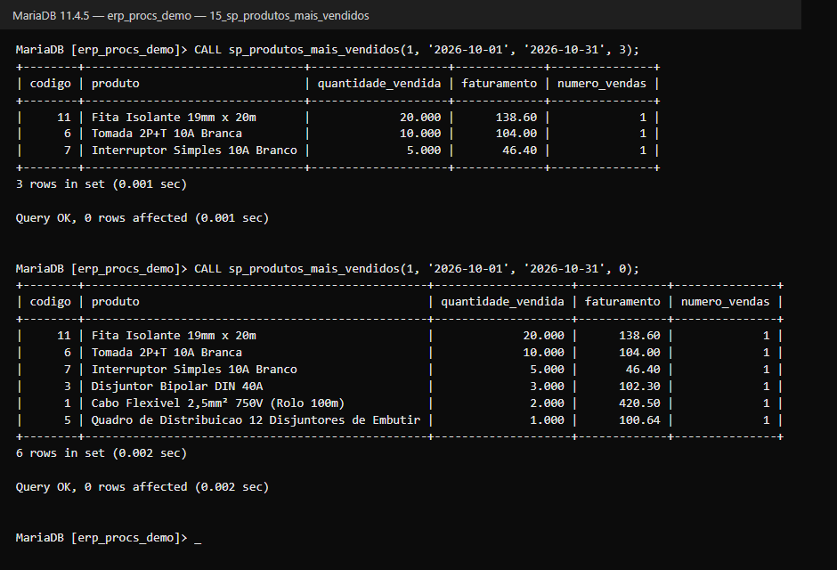

<details>
<summary>Código SQL</summary>

```sql
DELIMITER $$
CREATE PROCEDURE sp_produtos_mais_vendidos(
    IN p_tenant_id BIGINT UNSIGNED,
    IN p_inicio DATE,
    IN p_fim DATE,
    IN p_limite INT
)
BEGIN
    DECLARE v_limite INT DEFAULT 10;
    IF p_limite IS NOT NULL AND p_limite > 0 THEN
        SET v_limite = p_limite;
    END IF;

    SELECT
        p.code AS codigo,
        p.name AS produto,
        SUM(i.quantity) AS quantidade_vendida,
        SUM(i.total_price) AS faturamento,
        COUNT(DISTINCT i.sale_id) AS numero_vendas
    FROM sale_items i
    JOIN sales v ON v.id = i.sale_id
    JOIN products p ON p.id = i.product_id
    WHERE v.tenant_id = p_tenant_id
      AND v.status = 'completed'
      AND v.created_at >= p_inicio
      AND v.created_at < DATE_ADD(p_fim, INTERVAL 1 DAY)
    GROUP BY p.id, p.code, p.name
    ORDER BY quantidade_vendida DESC, faturamento DESC
    LIMIT v_limite;
END $$
DELIMITER ;
```

</details>

### sp_comissao_vendedores

Comissão de cada vendedor no período: total das vendas em que ele foi o vendedor × o percentual do
cadastro do colaborador. A venda #4 não tinha vendedor e não entra. Maria vendeu R$ 420,50 +
R$ 202,94 = R$ 623,44.

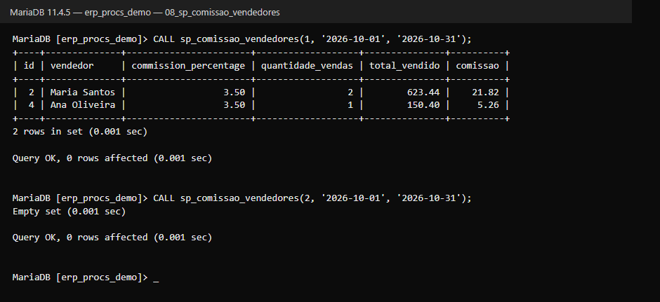

<details>
<summary>Código SQL</summary>

```sql
DELIMITER $$
CREATE PROCEDURE sp_comissao_vendedores(
    IN p_tenant_id BIGINT UNSIGNED,
    IN p_data_inicio DATE,
    IN p_data_fim DATE
)
BEGIN
    IF p_data_inicio IS NULL OR p_data_fim IS NULL OR p_data_inicio > p_data_fim THEN
        SIGNAL SQLSTATE '45000'
            SET MESSAGE_TEXT = 'Periodo invalido: informe data inicial menor ou igual a final.';
    END IF;

    SELECT e.id, e.name AS vendedor, e.commission_percentage,
           COUNT(s.id) AS quantidade_vendas,
           SUM(s.total_amount) AS total_vendido,
           ROUND(SUM(s.total_amount) * e.commission_percentage / 100, 2) AS comissao
    FROM employees e
    JOIN sales s ON s.seller_id = e.id AND s.tenant_id = e.tenant_id
    WHERE e.tenant_id = p_tenant_id
      AND e.deleted_at IS NULL
      AND s.status = 'completed'
      AND s.created_at >= p_data_inicio
      AND s.created_at < p_data_fim + INTERVAL 1 DAY
    GROUP BY e.id, e.name, e.commission_percentage
    ORDER BY total_vendido DESC;
END $$
DELIMITER ;
```

</details>

### sp_resumo_caixa

Resumo de um turno de caixa: fundo de troco, vendas por forma de pagamento, suprimentos, sangrias
e o saldo esperado na gaveta. Usa o mesmo cálculo da tela de fechamento
(`CashShiftService::getSummary`). A coluna `troco_devolvido` aparece separada porque o saldo
esperado do sistema soma o dinheiro **entregue** pelo cliente sem descontar o troco — veja as
Observações. O turno 1 é da empresa 1, então a empresa 2 recebe `Empty set`.

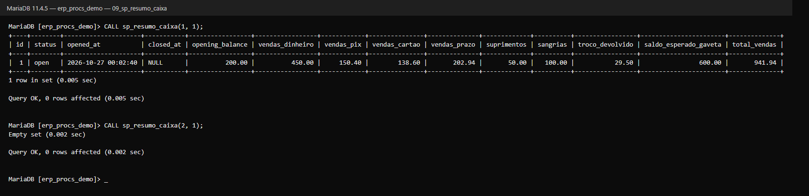

<details>
<summary>Código SQL</summary>

```sql
DELIMITER $$
CREATE PROCEDURE sp_resumo_caixa(
    IN p_tenant_id BIGINT UNSIGNED,
    IN p_cash_shift_id BIGINT UNSIGNED
)
BEGIN
    SELECT r.id, r.status, r.opened_at, r.closed_at, r.opening_balance,
           r.vendas_dinheiro, r.vendas_pix, r.vendas_cartao, r.vendas_prazo,
           r.suprimentos, r.sangrias, r.troco_devolvido,
           r.opening_balance + r.vendas_dinheiro + r.suprimentos - r.sangrias AS saldo_esperado_gaveta,
           r.vendas_dinheiro + r.vendas_pix + r.vendas_cartao + r.vendas_prazo AS total_vendas
    FROM (
        SELECT cs.id, cs.status, cs.opened_at, cs.closed_at, cs.opening_balance,
               (SELECT COALESCE(SUM(pg.amount), 0) FROM sale_payments pg
                  JOIN sales s ON s.id = pg.sale_id
                 WHERE pg.tenant_id = cs.tenant_id AND s.cash_shift_id = cs.id
                   AND s.status = 'completed' AND pg.payment_method = 'money') AS vendas_dinheiro,
               (SELECT COALESCE(SUM(pg.amount), 0) FROM sale_payments pg
                  JOIN sales s ON s.id = pg.sale_id
                 WHERE pg.tenant_id = cs.tenant_id AND s.cash_shift_id = cs.id
                   AND s.status = 'completed' AND pg.payment_method = 'pix') AS vendas_pix,
               (SELECT COALESCE(SUM(pg.amount), 0) FROM sale_payments pg
                  JOIN sales s ON s.id = pg.sale_id
                 WHERE pg.tenant_id = cs.tenant_id AND s.cash_shift_id = cs.id
                   AND s.status = 'completed'
                   AND pg.payment_method IN ('credit_card', 'debit_card')) AS vendas_cartao,
               (SELECT COALESCE(SUM(pg.amount), 0) FROM sale_payments pg
                  JOIN sales s ON s.id = pg.sale_id
                 WHERE pg.tenant_id = cs.tenant_id AND s.cash_shift_id = cs.id
                   AND s.status = 'completed' AND pg.payment_method = 'on_account') AS vendas_prazo,
               (SELECT COALESCE(SUM(m.amount), 0) FROM cash_movements m
                 WHERE m.tenant_id = cs.tenant_id AND m.cash_shift_id = cs.id
                   AND m.type = 'inflow') AS suprimentos,
               (SELECT COALESCE(SUM(m.amount), 0) FROM cash_movements m
                 WHERE m.tenant_id = cs.tenant_id AND m.cash_shift_id = cs.id
                   AND m.type = 'outflow') AS sangrias,
               (SELECT COALESCE(SUM(s.change_amount), 0) FROM sales s
                 WHERE s.tenant_id = cs.tenant_id AND s.cash_shift_id = cs.id
                   AND s.status = 'completed') AS troco_devolvido
        FROM cash_shifts cs
        WHERE cs.tenant_id = p_tenant_id
          AND cs.id = p_cash_shift_id
    ) AS r;
END $$
DELIMITER ;
```

</details>

### sp_contas_receber_cliente

Parcelas em aberto (pendentes ou vencidas) do crediário de um cliente, com saldo e dias de atraso.
Usa dois parâmetros no `WHERE` além da empresa (exercício 13). O cliente 2 não tem parcelas em
aberto.

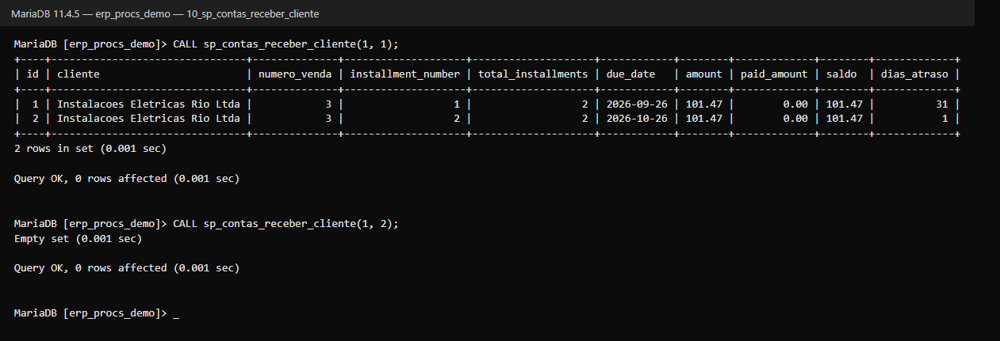

<details>
<summary>Código SQL</summary>

```sql
DELIMITER $$
CREATE PROCEDURE sp_contas_receber_cliente(
    IN p_tenant_id BIGINT UNSIGNED,
    IN p_customer_id BIGINT UNSIGNED
)
BEGIN
    SELECT r.id, c.name AS cliente, v.code AS numero_venda,
           r.installment_number, r.total_installments, r.due_date,
           r.amount, r.paid_amount, (r.amount - r.paid_amount) AS saldo,
           GREATEST(DATEDIFF(UTC_DATE(), r.due_date), 0) AS dias_atraso
    FROM customer_receivables r
    JOIN customers c ON c.id = r.customer_id AND c.tenant_id = r.tenant_id
    JOIN sales v ON v.id = r.sale_id AND v.tenant_id = r.tenant_id
    WHERE r.tenant_id = p_tenant_id
      AND r.customer_id = p_customer_id
      AND c.deleted_at IS NULL
      AND r.status IN ('pending', 'overdue')
    ORDER BY r.due_date, r.installment_number;
END $$
DELIMITER ;
```

</details>

### sp_clientes_inadimplentes

Clientes com títulos do crediário vencidos há mais de N dias e ainda com saldo em aberto,
ordenados do maior valor devido para o menor. Títulos pagos ou cancelados não entram. A parcela de
26/09 está 30 dias atrasada: entra no filtro de 15 dias e fica fora do de 60.

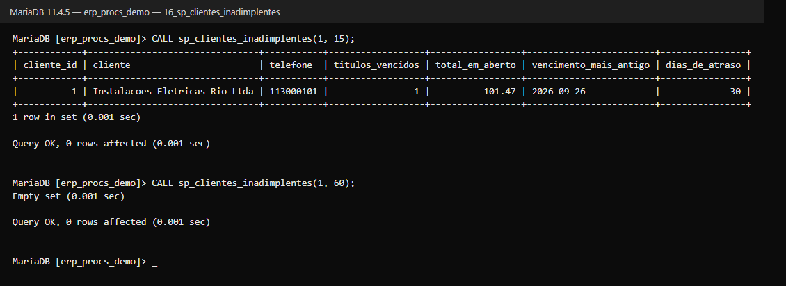

<details>
<summary>Código SQL</summary>

```sql
DELIMITER $$
CREATE PROCEDURE sp_clientes_inadimplentes(
    IN p_tenant_id BIGINT UNSIGNED,
    IN p_dias INT
)
BEGIN
    SELECT
        c.id AS cliente_id,
        c.name AS cliente,
        c.phone AS telefone,
        COUNT(r.id) AS titulos_vencidos,
        SUM(r.amount - r.paid_amount) AS total_em_aberto,
        MIN(r.due_date) AS vencimento_mais_antigo,
        DATEDIFF(CURRENT_DATE, MIN(r.due_date)) AS dias_de_atraso
    FROM customer_receivables r
    JOIN customers c ON c.id = r.customer_id
    WHERE r.tenant_id = p_tenant_id
      AND r.status IN ('pending', 'overdue')
      AND r.amount > r.paid_amount
      AND r.due_date < DATE_SUB(CURRENT_DATE, INTERVAL GREATEST(COALESCE(p_dias, 0), 0) DAY)
    GROUP BY c.id, c.name, c.phone
    ORDER BY total_em_aberto DESC;
END $$
DELIMITER ;
```

</details>

---

## Alteração com transação

### sp_ajustar_estoque

Faz uma entrada (quantidade positiva) ou saída (quantidade negativa) de estoque e grava o
movimento no kardex (`stock_movements`), tudo numa transação. Devolve o novo saldo no parâmetro de
saída `p_novo_saldo`.

Passo a passo dentro da procedure:

1. Recusa quantidade zero ou vazia.
2. Abre a transação e lê o saldo do produto **travando a linha** (`SELECT ... FOR UPDATE`).
3. Recusa se o produto não existir **nesta empresa** ou se a saída deixar o saldo negativo.
4. Atualiza o saldo em `products`.
5. Grava o movimento no kardex: tipo `in` (entrada) ou `out` (saída), quantidade, saldo anterior,
   saldo novo e o motivo. É o mesmo formato que o sistema usa quando a movimentação é feita pela tela.
6. Confirma a transação (`COMMIT`).

Se qualquer passo falhar, o `EXIT HANDLER` desfaz tudo (`ROLLBACK`) e devolve o erro (`RESIGNAL`):
o saldo e o kardex ficam como estavam.

| Situação | Mensagem do banco |
|---|---|
| Quantidade zero | `Informe uma quantidade diferente de zero.` |
| Produto de outra empresa ou inexistente | `Produto não encontrado nesta empresa.` |
| Saída maior que o saldo | `Estoque insuficiente para essa saída.` |

No print: entrada de 10 e saída de 4 unidades do produto 5, as duas recusas, e o kardex mostrando
os dois movimentos gravados (e nenhum das chamadas recusadas).

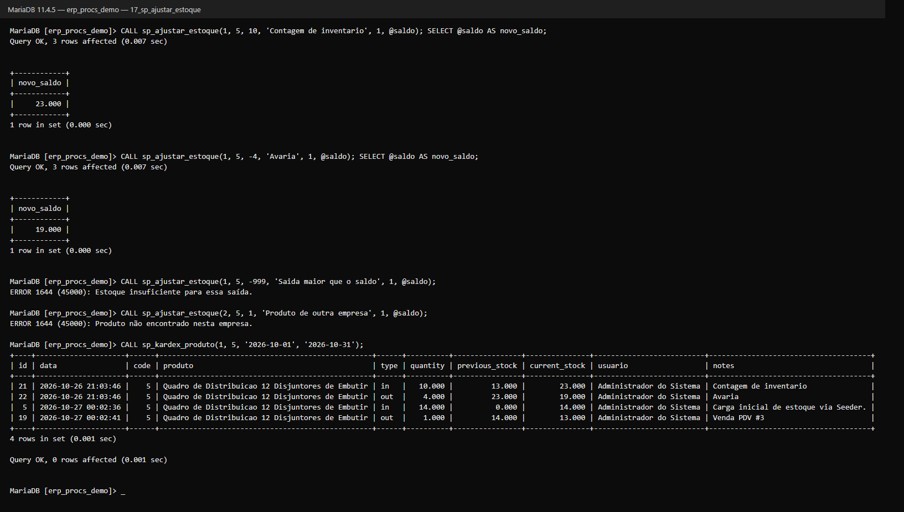

<details>
<summary>Código SQL</summary>

```sql
DELIMITER $$
CREATE PROCEDURE sp_ajustar_estoque(
    IN p_tenant_id BIGINT UNSIGNED,
    IN p_produto_id BIGINT UNSIGNED,
    IN p_quantidade DECIMAL(12,3),
    IN p_motivo VARCHAR(255),
    IN p_usuario_id BIGINT UNSIGNED,
    OUT p_novo_saldo DECIMAL(12,3)
)
BEGIN
    DECLARE v_saldo_atual DECIMAL(12,3);
    DECLARE v_custo DECIMAL(12,2);

    DECLARE EXIT HANDLER FOR SQLEXCEPTION
    BEGIN
        ROLLBACK;
        RESIGNAL;
    END;

    IF p_quantidade IS NULL OR p_quantidade = 0 THEN
        SIGNAL SQLSTATE '45000' SET MESSAGE_TEXT = 'Informe uma quantidade diferente de zero.';
    END IF;

    START TRANSACTION;

    -- Trava a linha do produto: dois ajustes ao mesmo tempo nao se atropelam.
    SELECT current_stock, cost_price INTO v_saldo_atual, v_custo
    FROM products
    WHERE id = p_produto_id AND tenant_id = p_tenant_id AND deleted_at IS NULL
    FOR UPDATE;

    IF v_saldo_atual IS NULL THEN
        SIGNAL SQLSTATE '45000' SET MESSAGE_TEXT = 'Produto não encontrado nesta empresa.';
    END IF;

    IF v_saldo_atual + p_quantidade < 0 THEN
        SIGNAL SQLSTATE '45000' SET MESSAGE_TEXT = 'Estoque insuficiente para essa saída.';
    END IF;

    SET p_novo_saldo = v_saldo_atual + p_quantidade;

    UPDATE products
    SET current_stock = p_novo_saldo, updated_at = NOW()
    WHERE id = p_produto_id;

    INSERT INTO stock_movements
        (tenant_id, product_id, user_id, type, quantity, unit_price,
         previous_stock, current_stock, notes, created_at, updated_at)
    VALUES
        (p_tenant_id, p_produto_id, p_usuario_id,
         IF(p_quantidade > 0, 'in', 'out'), ABS(p_quantidade), COALESCE(v_custo, 0),
         v_saldo_atual, p_novo_saldo, p_motivo, NOW(), NOW());

    COMMIT;
END $$
DELIMITER ;
```

</details>

---

## Ambientes

- **Produção (MySQL 5.7, HostGator):** as procedures são criadas pelas migrations
  (`php artisan migrate`). Foram escritas sem recursos do MySQL 8 (sem CTE nem funções de janela),
  para rodar na versão do servidor. Também rodam no MariaDB 10.2+.
- **Local e testes (SQLite):** o SQLite não tem stored procedures, então as migrations não fazem
  nada nesse banco e o sistema continua funcionando normalmente. As telas do sistema não dependem
  das procedures.

Para instalar sem SSH, pelo phpMyAdmin do cPanel: abra o banco, aba **SQL**, cole o código de uma
procedure (o bloco "Código SQL" de cada seção, com as linhas `DELIMITER`) e execute. Para recriar
uma procedure, rode antes `DROP PROCEDURE IF EXISTS nome;`. Para conferir:

| Verificação | Comando | O que esperar |
|---|---|---|
| Versão do banco | `SELECT VERSION();` | MySQL 5.7+ ou MariaDB 10.2+ |
| Permissão para criar procedures | `SHOW GRANTS;` | `ALL PRIVILEGES` ou `CREATE ROUTINE` no banco do sistema |
| Procedures criadas | `SHOW PROCEDURE STATUS WHERE Db = DATABASE();` | As 17 procedures listadas |
| Código de uma procedure | `SHOW CREATE PROCEDURE nome;` | O `CREATE PROCEDURE` completo |

Não existe `ALTER` para o corpo de uma procedure: para mudar o código, `DROP` e `CREATE` de novo.
Remover uma procedure não apaga nenhum dado.

## Usando as procedures no Laravel

Os Repositories chamam as procedures com `DB::select('CALL ...')`, sempre com *bindings* (`?`) e
nunca interpolando valores no SQL. O `tenant_id` vem da empresa ativa (`TenantManager`), nunca de
quem chama:

```php
use Modules\Estoque\App\Repositories\ProductProcedureRepository;

$produtos = app(ProductProcedureRepository::class)->searchForPos('cabo');
// executa: CALL sp_pdv_buscar_produto(?, ?) com [id da empresa ativa, 'cabo']
```

| Repository | Métodos |
|---|---|
| `ProductProcedureRepository` (Estoque) | `findById`, `searchForPos`, `byCategory`, `byPriceRange`, `listOrdered`, `belowMinimumStock`, `stockLedger`, `create`, `updateRetailPrice`, `softDelete` |
| `SaleProcedureRepository` (Vendas) | `salesByPeriod`, `topSellingProducts`, `sellerCommissions`, `cashShiftSummary`, `openReceivables` |

Um erro de `SIGNAL` chega ao Laravel como `Illuminate\Database\QueryException`, com a mensagem da
procedure.

## Testes feitos

**Execução manual (exercícios 17 a 24):** todos os `CALL` dos prints acima foram executados em
sequência, no MariaDB 11.4.5, com os dados descritos em [Dados usados nos exemplos](#dados-usados-nos-exemplos).

| Situação | Resultado |
|---|---|
| Chamadas com valores válidos | Executaram sem erro, com os valores esperados |
| Valor inexistente ou de outra empresa em consulta | `Empty set` (ou linha zerada nos totais), sem erro |
| Valor inválido (faixa invertida, campo fora da lista, NCM curto, período invertido, saída maior que o saldo) | Erro `1644 (45000)` com a mensagem da procedure, sem alterar dados |
| Alterar ou excluir produto inexistente ou de outra empresa | Erro `Produto nao encontrado nesta empresa.`, sem alterar dados |

**Testes automatizados:**

| Arquivo | Testes | O que cobre |
|---|---|---|
| `Modules/Estoque/tests/Feature/ProductProceduresTest.php` | 20 | As 10 procedures de produto, incluindo: a empresa A não enxerga produtos da empresa B; maiúsculas e minúsculas; curingas do `LIKE`; códigos consecutivos na inserção; erros de validação. |
| `Modules/Vendas/tests/Feature/SaleProceduresTest.php` | 5 | As 5 procedures de vendas usadas pelo `SaleProcedureRepository`, com vendas feitas pelo próprio PDV; venda cancelada e de outra empresa não entram; o resumo de caixa bate com `CashShiftService`. |

Os 25 testes passaram no MariaDB 11.4.5. Eles só rodam no MySQL/MariaDB; na suíte normal (SQLite)
aparecem como *skipped*. Para rodar contra um banco local:

```bash
DB_CONNECTION=mariadb DB_HOST=127.0.0.1 DB_PORT=3306 DB_DATABASE=erp_faculdade_testing \
DB_USERNAME=root DB_PASSWORD= php vendor/bin/phpunit \
  Modules/Estoque/tests/Feature/ProductProceduresTest.php \
  Modules/Vendas/tests/Feature/SaleProceduresTest.php
```

(`erp_faculdade_testing` precisa existir e é apagado e recriado a cada execução — nunca aponte
para o banco de produção. Com MySQL, use `DB_CONNECTION=mysql`.)

## Observações

- **Fuso horário.** O Laravel grava datas em UTC. Por isso as procedures de produto usam
  `UTC_TIMESTAMP()` em vez de `NOW()` (que usaria o fuso do servidor), e os filtros por data
  comparam com datas UTC. Uma venda feita às 22h de Brasília fica registrada no dia seguinte em
  UTC — o mesmo comportamento das telas do sistema. A exceção é `sp_ajustar_estoque`, que grava
  com `NOW()`: no print do kardex, o ajuste feito às 21h (horário do servidor) aparece antes da
  carga inicial gravada às 00h em UTC.
- **Troco no caixa.** No pagamento em dinheiro o PDV grava o valor entregue pelo cliente (ex.:
  R$ 450,00 para uma venda de R$ 420,50). O saldo esperado da gaveta, tanto na tela de fechamento
  quanto em `sp_resumo_caixa`, soma esse valor sem descontar o troco — no exemplo, R$ 600,00 em vez
  de R$ 570,50. A procedure mostra `troco_devolvido` à parte para deixar a diferença visível.
- **Código interno concorrente.** `sp_inserir_produto` calcula o próximo código com `MAX(code) + 1`,
  como o sistema. Se duas inserções na mesma empresa acontecerem no mesmo instante, a segunda falha
  no índice único `tenant_id + code` em vez de gravar um código repetido.
- **Exclusão pela tela x pela procedure.** O botão de excluir da tela de produtos só **desativa** o
  produto (`is_active = 0`), que continua aparecendo nas listas de cadastro. `sp_excluir_produto`
  faz a exclusão lógica (`deleted_at`), que tira o produto de todas as consultas.

## Conclusão

Com parâmetros, cada procedure resolve uma família inteira de consultas: `sp_produtos_por_faixa_preco`
atende qualquer faixa, em qualquer tabela de preço, de qualquer empresa, com um único código salvo
no banco. Isso as torna **reutilizáveis** (o mesmo `CALL` serve ao phpMyAdmin, a um relatório e ao
Laravel), **organizadas** (a regra — "só a empresa ativa", "ignora excluídos", "margem sobre o
custo" — fica escrita num lugar só) e **eficientes** (o banco guarda o código pronto e só recebe os
valores a cada chamada). Os parâmetros tipados e a validação com `SIGNAL` também protegem os dados:
um valor fora do esperado é recusado com uma mensagem clara antes de chegar às tabelas.
