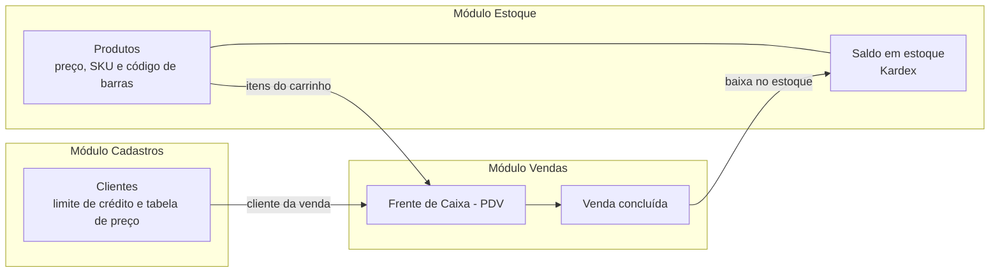

# Telas do Sistema

Esta página apresenta as principais telas da primeira versão funcional do ERP: **Frente de Caixa (PDV)**, **Cadastro de Clientes** e **Controle de Estoque**, que formam o MVP do projeto.

## Como os módulos se relacionam

Ao concluir uma venda, o sistema registra automaticamente a saída de cada item no Kardex do Estoque. Se a venda for cancelada, o estoque é estornado.

| Módulo | Tela | Função no sistema |
| :--- | :--- | :--- |
| **Vendas** | Frente de Caixa (PDV) | Registra as vendas do balcão, com leitura de código de barras, descontos e formas de pagamento |
| **Cadastros** | Carteira de Clientes | Gerencia os clientes, seus limites de crédito para o crediário e as tabelas de preço vinculadas |
| **Estoque** | Controle de Estoque | Gerencia o catálogo de produtos, a precificação e os níveis de inventário |

---

## Frente de Caixa (PDV)

| Recurso | Descrição |
| :--- | :--- |
| **Controle de turno** | O caixa é aberto por um operador; permite sangria, suprimento e fechamento |
| **Leitura de produtos** | Por código de barras ou código simples (#1, #2...), ou pela busca no estoque com a tecla F2 |
| **Carrinho** | Ajuste de quantidade, remoção de itens e cálculo automático do total |
| **Cliente e tabela de preço** | Venda para consumidor final ou cliente cadastrado, com tabela Varejo, Revenda ou Atacado |
| **Descontos** | Em percentual ou em valor, com o abatimento total exibido no resumo |
| **Pagamento** | Uma ou mais formas de pagamento na mesma venda, com valor sugerido |

---

## Cadastro de Clientes

| Recurso | Descrição |
| :--- | :--- |
| **Pessoa física e jurídica** | Cadastro de clientes PF (CPF) e PJ (CNPJ) |
| **Tabela de preço padrão** | Cada cliente tem sua tabela (Varejo, Revenda, Atacado), aplicada automaticamente no PDV |
| **Limite de crédito** | Valor máximo liberado para compras no crediário |
| **Busca** | Por nome, CPF/CNPJ, telefone ou cidade |
| **Status** | Filtros de clientes ativos e inativos, com opção de desativar |

---

## Controle de Estoque

| Recurso | Descrição |
| :--- | :--- |
| **Indicadores** | Total no catálogo, estoque crítico (abaixo do mínimo), itens zerados e categorias ativas |
| **Identificação do produto** | Código simples, SKU e código de barras (EAN) |
| **Categorias** | Organização por categorias e subcategorias |
| **Saldo atual** | Quantidade disponível com a unidade de medida (UN, PCT, PC...) |
| **Extrato Kardex** | Histórico de entradas e saídas de cada produto |
| **Busca e filtros** | Por nome, código, SKU, código de barras, categoria e status |