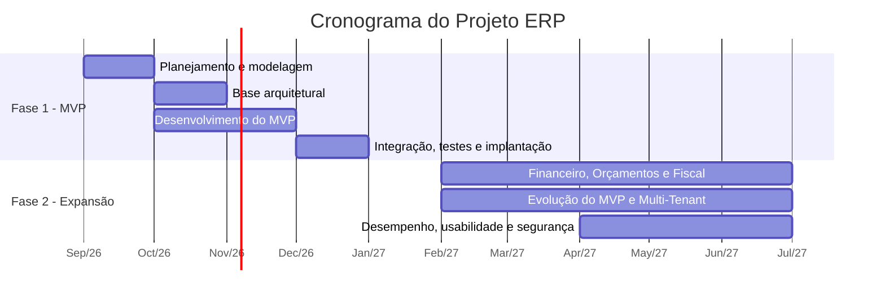

# Viabilidade Operacional

A Viabilidade Operacional avalia o conhecimento necessário para construir o projeto: o planejamento, a modelagem e o desenvolvimento de um Sistema Integrado de Gestão Empresarial (ERP) baseado em arquitetura Web modular.

### Conhecimentos Necessários

| Área de Conhecimento | Aplicação no Projeto | Etapas em que é Utilizado |
| :--- | :--- | :--- |
| **Desenvolvimento de sistemas Web** | Construção da aplicação e de suas funcionalidades | Desenvolvimento, manutenção |
| **Lógica de programação** | Implementação das regras de negócio | Desenvolvimento, testes |
| **Modelagem de dados** | Estruturação do banco de dados e dos relacionamentos | Análise, planejamento |
| **Desenvolvimento de interfaces** | Criação das telas e da experiência do usuário | Desenvolvimento |
| **Controle de versão** | Gerenciamento do código-fonte e colaboração da equipe | Todas as etapas |

### Ferramentas Utilizadas no Projeto

| Tecnologias / Ferramenta | Conhecimento Necessário | Papel no projeto |
| :--- | :--- | :--- |
| **PHP 8.3+** | Saber como planejar e executar as demandas do projeto utilizando da linguagem de programação para o desenvolvimento do programa, por meio da interpretação, lógica e conhecimento. Ter experiência prévia em programação e áreas correlatas da tecnologia. | Linguagem Principal |
| **Laravel 13** | Saber como utilizar o framework Laravel para o desenvolvimento do projeto, por meio da utilização de suas ferramentas, recursos, estrutura e funcionalidades. Ter experiência prévia com desenvolvimento de aplicações utilizando PHP e conhecimento em frameworks backend. | Framework Backend |
| **MySQL** | Saber como utilizar o banco de dados MySQL para o armazenamento e gerenciamento das informações do projeto, por meio da criação, consulta, alteração e exclusão de dados. Ter experiência prévia com bancos de dados relacionais e conhecimento em SQL. | Banco de Dados Relacional |
| **Blade Templates & Tailwind CSS** | Saber como desenvolver e estruturar as interfaces do projeto utilizando o sistema de templates Blade e o framework Tailwind CSS, por meio da criação, organização e estilização das páginas. Ter experiência prévia com desenvolvimento frontend e conhecimento em HTML e CSS. | Camada de Apresentação (UI) |
| **Git & GitHub** | Saber como utilizar as ferramentas Git e GitHub para o controle e gerenciamento do código-fonte do projeto, por meio da criação de commits, branches, versionamento e compartilhamento do código. Ter experiência prévia com controle de versão e desenvolvimento colaborativo. | Controle de Versão |

# Viabilidade Técnica

A Viabilidade Técnica analisa se os recursos tecnológicos, ferramentas, linguagens e infraestrutura escolhidos são adequados para construir e manter o ERP.

| Camada / Recurso | Tecnologia | Função no Projeto | Justificativa da Viabilidade |
| :--- | :--- | :--- | :--- |
| **Linguagem principal** | PHP 8.3+ | Implementação das regras de negócio e funcionalidades | Linguagem robusta para o desenvolvimento de aplicações Web |
| **Framework** | Laravel | Organização da aplicação, rotas, autenticação, validações e acesso ao banco | Oferece recursos prontos e suporte a uma arquitetura modular |
| **Banco de dados** | MySQL | Armazenamento e gerenciamento das informações | Banco relacional capaz de lidar com grandes volumes de dados e múltiplos relacionamentos; integração nativa com o Laravel |
| **Apresentação** | Blade Templates | Construção dinâmica das páginas | Integrado ao Laravel, permite reaproveitar componentes entre os módulos |
| **Estilização** | Tailwind CSS | Criação e padronização dos elementos visuais | Facilita interfaces organizadas e responsivas |
| **Controle de versão** | Git & GitHub | Histórico de alterações, branches e colaboração | Mantém o histórico das modificações e facilita a manutenção e evolução |
| **Arquitetura** | Web modular | Separação do ERP em módulos independentes | Permite expandir o sistema conforme novas necessidades e separa as responsabilidades entre camadas |

**Conclusão:** as ferramentas escolhidas são compatíveis entre si e possuem os recursos necessários para o desenvolvimento, a implantação, a manutenção e a futura expansão do sistema. Portanto, o projeto apresenta **viabilidade técnica**.

# Viabilidade de Cronograma

A primeira versão funcional do ERP será desenvolvida entre setembro e dezembro de 2026. A segunda fase, de expansão, ocorrerá entre fevereiro e junho de 2027.

### Decisões Arquiteturais que Sustentam o Cronograma

| Decisão | Descrição | Impacto no Cronograma |
| :--- | :--- | :--- |
| **Monólito Modular** | Módulos organizados dentro de uma única aplicação Laravel | Evita a complexidade de microsserviços e acelera o desenvolvimento |
| **Multi-Tenancy desde o início** | Estrutura de tenants e isolamento de dados criados já na fase de arquitetura | Evita retrabalho na estrutura de dados e nas regras de acesso ao migrar para SaaS |
| **Eventos de Domínio, Contratos e Interfaces** | Comunicação desacoplada entre módulos (ex.: venda concluída no PDV gera evento que baixa o estoque) | Novos módulos são integrados sem alterar os existentes |
| **Foco inicial no MVP** | Prioridade para os módulos de PDV, Estoque e Clientes | Reduz o escopo da primeira entrega a um período viável |
| **Testes progressivos** | Testes durante todo o desenvolvimento, intensificados em dezembro | Identifica problemas de integração, isolamento, regras de negócio e desempenho antes da implantação |

### Fase 1 — Primeira Versão Funcional (setembro a dezembro de 2026)

| Período | Etapa | Atividades |
| :--- | :--- | :--- |
| **Setembro/2026** | Planejamento | Levantamento de requisitos e modelagem |
| **Outubro/2026** | Base arquitetural | Monólito Modular, Multi-Tenancy, eventos e contratos |
| **Outubro a novembro/2026** | Desenvolvimento do MVP | Módulos de PDV, Estoque e Clientes |
| **Dezembro/2026** | Integração e implantação | Integração, testes, documentação e implantação |

**Resultado esperado:** primeira versão funcional do ERP, preparada para receber os demais módulos.

### Fase 2 — Expansão e Aprimoramento (fevereiro a junho de 2027)

| Frente de Trabalho | Atividades |
| :--- | :--- |
| **Novos módulos** | Financeiro, Orçamentos e emissão de documentos fiscais |
| **Evolução do MVP** | Melhorias em PDV, Estoque e Clientes |
| **Multi-Tenant** | Aprimoramentos para atender diferentes empresas de forma segura e independente |
| **Qualidade** | Melhorias de desempenho, usabilidade e segurança |
| **Integração** | Novos módulos conectados por eventos, contratos e interfaces, mantendo baixo acoplamento |

**Resultado esperado:** versão mais completa e consolidada do ERP, preparada para disponibilização como solução SaaS.

# Viabilidade Econômica

Estudo de viabilidade econômica e financeira para o desenvolvimento do software por uma equipe de **5 sócios**, simulando a operação de uma microempresa de tecnologia ao longo de **30 meses (2 anos e meio)**.

---

## 1. Premissas do Projeto

| Premissa | Valor Adotado | Observação |
| :--- | :--- | :--- |
| **Duração do projeto** | 30 meses (2,5 anos) | — |
| **Tamanho da equipe** | 5 sócios | Desenvolvedores e gestores |
| **Modelo de trabalho** | Remoto / Híbrido flexível | Reduz custos de infraestrutura física |
| **Remuneração dos sócios** | R$ 10.000,00 / mês por sócio | Pró-labore bruto; o INSS do sócio (11%, limitado ao teto) é descontado do próprio pró-labore |
| **Regime tributário** | Simples Nacional — Anexo III (via Fator R) | Software/SaaS é Anexo V por padrão; com folha ≥ 28% da receita, passa ao Anexo III |
| **Alíquota efetiva** | **≈ 12,59%** sobre o faturamento bruto | 4ª faixa do Anexo III (detalhada na seção 3) |
| **Margem de lucro** | 20% sobre os custos operacionais | Reserva técnica, investimento interno e remuneração do negócio |

---

## 2. Detalhamento dos Custos (30 Meses)

| Categoria | Descrição / Itens Incluídos | Custo Mensal / Pontual | Custo Total (30 Meses) |
| :--- | :--- | :--- | ---: |
| **Investimento Inicial (CAPEX)** | 5 laptops de alta performance (R$ 10.000/un) | Pontual (Mês 1) | R$ 50.000,00 |
| **Folha de Pagamento (Sócios)** | Pró-labore de R$ 10.000,00/mês × 5 sócios | R$ 50.000,00 / mês | R$ 1.500.000,00 |
| **Benefícios** | Plano de saúde empresarial (R$ 600/sócio) e ajuda de custo para internet/home office (R$ 500/sócio) | R$ 5.500,00 / mês | R$ 165.000,00 |
| **Serviços Operacionais e Legais** | Contabilidade especializada, assessoria jurídica (contratos) e conta bancária PJ | R$ 2.000,00 / mês | R$ 60.000,00 |
| **Infraestrutura Cloud & Servidores** | AWS / Google Cloud (servidores de dev/prod, banco de dados, storage e CDN) | R$ 1.500,00 / mês | R$ 45.000,00 |
| **Licenças de Software & Ferramentas** | GitHub Team, Figma, Jira/Notion, Google Workspace, Claude, IDEs e domínios | R$ 2.000,00 / mês | R$ 60.000,00 |
| **Despesas de Escritório / Eventuais** | Coworking sob demanda (reuniões com cliente) + reserva para imprevistos | R$ 800,00 / mês | R$ 24.000,00 |
| **Subtotal dos Custos Operacionais** | **Soma de todos os custos diretos e indiretos** | **R$ 63.466,67 / mês** (média) | **R$ 1.904.000,00** |

> O INSS patronal (CPP) não aparece como custo separado porque, no Anexo III, ele já está incluído na guia única do Simples (DAS).

---

## 3. Cálculo do Imposto (Simples Nacional — Anexo III)

A alíquota do Simples não é fixa: ela depende da **Receita Bruta dos últimos 12 meses (RBT12)**.

**Fórmula da alíquota efetiva:** `(RBT12 × Alíquota nominal − Parcela a deduzir) ÷ RBT12`

### Tabela do Anexo III

| Faixa | Receita Bruta em 12 Meses | Alíquota Nominal | Parcela a Deduzir |
| :---: | :--- | :---: | ---: |
| 1ª | Até R$ 180.000,00 | 6,00% | — |
| 2ª | De R$ 180.000,01 a R$ 360.000,00 | 11,20% | R$ 9.360,00 |
| 3ª | De R$ 360.000,01 a R$ 720.000,00 | 13,50% | R$ 17.640,00 |
| **4ª** | **De R$ 720.000,01 a R$ 1.800.000,00** | **16,00%** | **R$ 35.640,00** |
| 5ª | De R$ 1.800.000,01 a R$ 3.600.000,00 | 21,00% | R$ 125.640,00 |
| 6ª | De R$ 3.600.000,01 a R$ 4.800.000,00 | 33,00% | R$ 648.000,00 |

### Aplicação ao projeto

| Item | Cálculo | Valor |
| :--- | :--- | ---: |
| Receita bruta anual (RBT12) | Valor do contrato ÷ 30 × 12 | R$ 1.045.571,43 |
| Faixa de enquadramento | Entre R$ 720 mil e R$ 1,8 milhão | 4ª faixa |
| Imposto anual | R$ 1.045.571,43 × 16% − R$ 35.640,00 | R$ 131.651,43 |
| **Alíquota efetiva** | R$ 131.651,43 ÷ R$ 1.045.571,43 | **≈ 12,59%** |
| DAS médio mensal | R$ 131.651,43 ÷ 12 | R$ 10.970,95 |

### Verificação do Fator R

| Item | Cálculo | Valor |
| :--- | :--- | ---: |
| Folha de salários em 12 meses | R$ 50.000,00 × 12 (pró-labore) | R$ 600.000,00 |
| Receita bruta em 12 meses | — | R$ 1.045.571,43 |
| **Fator R** | Folha ÷ Receita | **≈ 57%** |
| Resultado | 57% ≥ 28% | Enquadrado no **Anexo III** ✅ |

> Se o Fator R ficasse abaixo de 28%, a empresa seria tributada pelo Anexo V, e a alíquota efetiva nesta mesma receita subiria para cerca de 18,9%.

---

## 4. Formação do Preço Final do Software

O imposto é calculado "por dentro", ou seja, incide sobre o próprio valor cobrado do cliente: **Preço = Subtotal ÷ (1 − alíquota efetiva)**.

| Etapa | Componente | Cálculo | Valor |
| :---: | :--- | :--- | ---: |
| 1 | Subtotal de Custos Operacionais | Soma da tabela de custos | R$ 1.904.000,00 |
| 2 | Margem de Lucro | 20% × R$ 1.904.000,00 | R$ 380.800,00 |
| 3 | **Subtotal antes dos Impostos** | (1) + (2) | **R$ 2.284.800,00** |
| 4 | Impostos (Simples Nacional ≈ 12,59%) | R$ 131.651,43/ano × 2,5 anos | R$ 329.128,57 |
| 5 | **Valor Total do Contrato** | (3) + (4) | **R$ 2.613.928,57** |

---

## 5. Resumo Financeiro Executivo

| Indicador | Valor | Forma de Cálculo |
| :--- | ---: | :--- |
| **Valor Total do Contrato** | R$ 2.613.928,57 | Preço final com margem e impostos |
| **Faturamento Mensal Necessário** | R$ 87.130,95 / mês | Valor total ÷ 30 meses (soma das mensalidades de todos os clientes) |
| **Custo Operacional Mensal Médio** | R$ 63.466,67 / mês | Subtotal de custos ÷ 30 meses |
| **Imposto Mensal Médio (DAS)** | R$ 10.970,95 / mês | Imposto anual ÷ 12 |
| **Lucro Mensal Médio** | R$ 12.693,33 / mês | Margem de lucro ÷ 30 meses |
| **Receita Média por Sócio** | R$ 17.426,19 / mês | Faturamento mensal ÷ 5 sócios |

> **Observação:** os valores seguem as regras do Simples Nacional vigentes em 2026. A Reforma Tributária (EC 132/2023) prevê a transição gradual de PIS/Cofins e ISS para CBS e IBS a partir de 2027. As empresas do Simples continuam recolhendo pela guia única, mas as alíquotas podem ser ajustadas ao longo da transição.